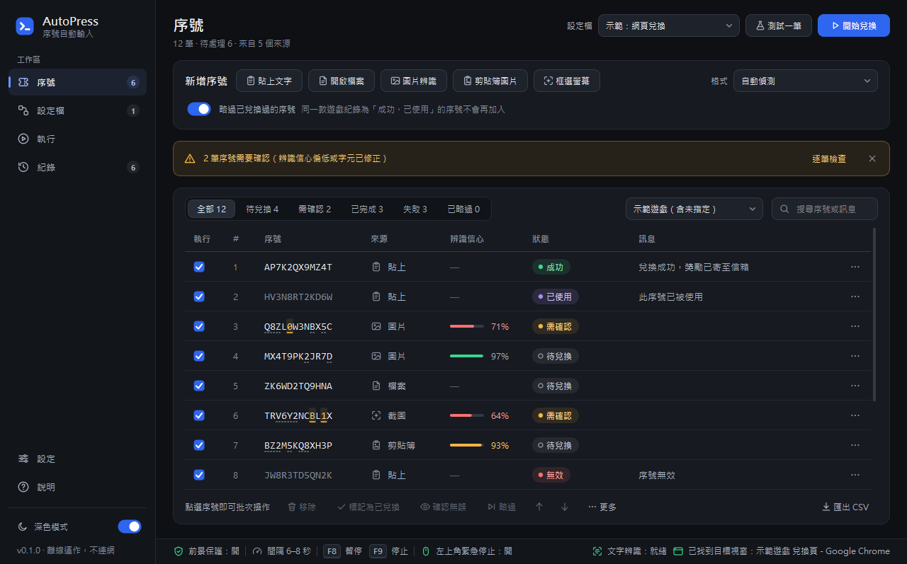
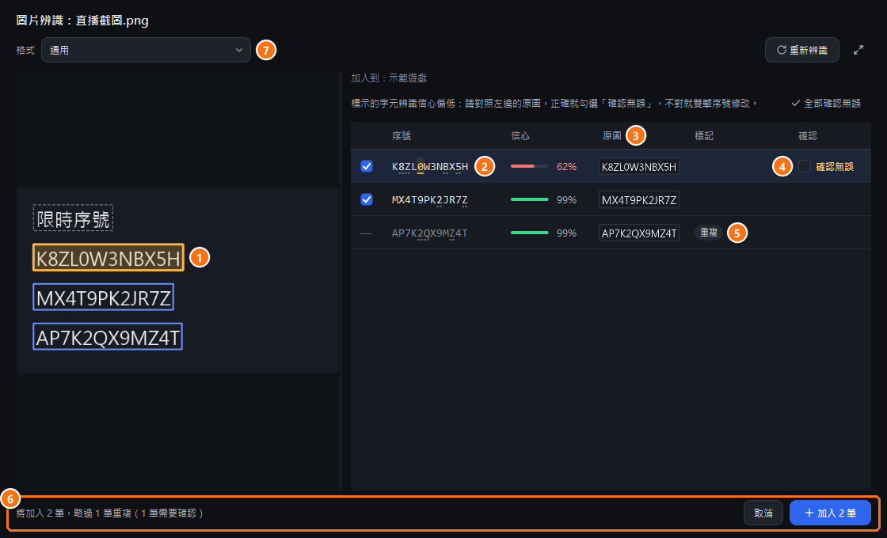
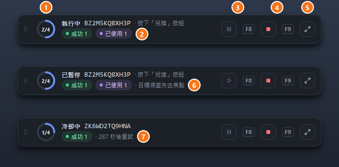
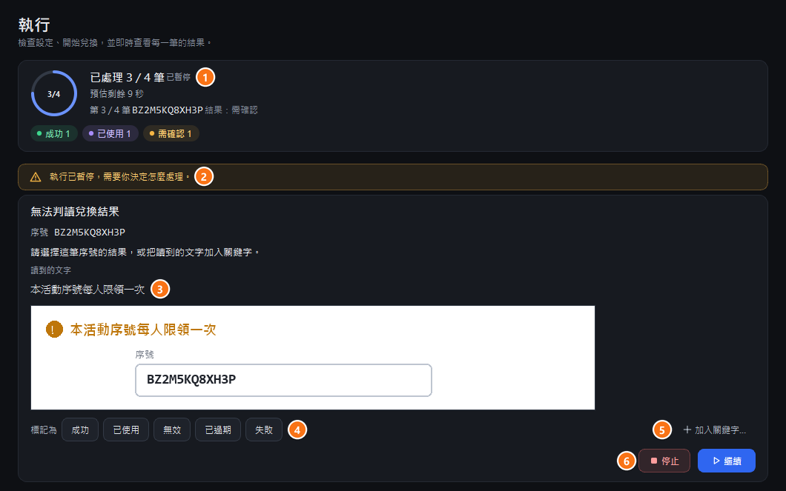
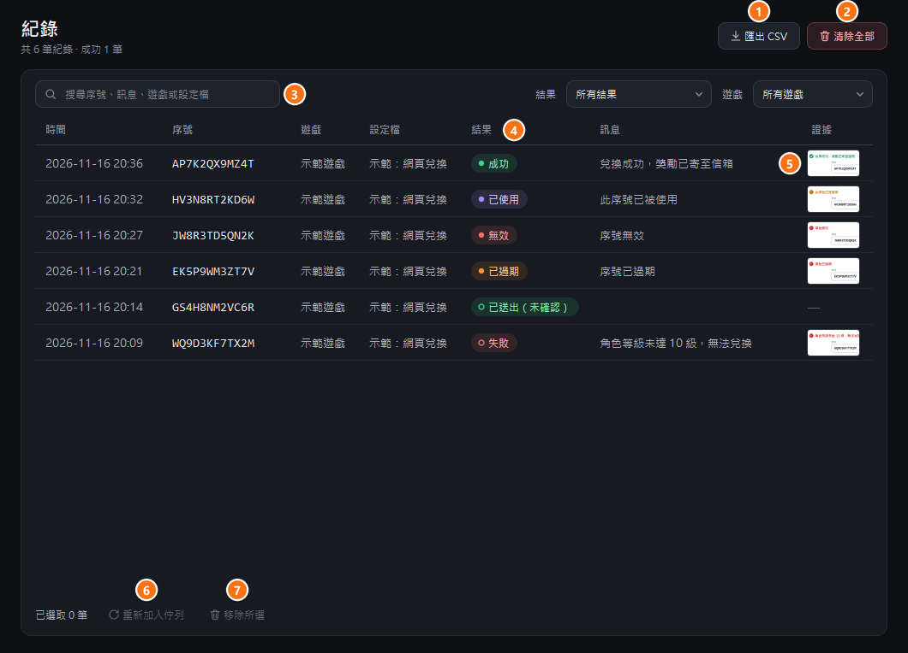

# AutoPress 序號自動輸入

**AutoPress** 是 Windows 10／11 上的遊戲兌換序號自動輸入工具。把手上的序號一次匯入（貼上、檔案、圖片辨識），它會照「設定檔」裡的步驟，一筆接一筆自動輸入、送出，並用文字辨識（OCR）讀出每筆的結果。通用型，不限定哪一款遊戲或哪一個兌換網頁。



- 下載：[GitHub Releases](https://github.com/Stardust-mio/AUTOPRESS/releases/latest)（「Assets」底下的 `AutoPress-0.1.0-win64.zip`，免安裝）
- 使用說明（截圖＋說明）：[docs/user_guide.md](docs/user_guide.md)。壓縮檔裡附的同一份是純文字檔、看不到圖片，請到 [GitHub 上的圖文版](https://github.com/Stardust-mio/AUTOPRESS/blob/main/docs/user_guide.md) 看；程式裡按 F1 也有「說明」頁
- 版本：0.1.0（第一個公開版本，見 [CHANGELOG.md](CHANGELOG.md)）
- 授權：GPL-3.0（見 [LICENSE](LICENSE)；第三方元件見 [THIRD-PARTY-NOTICES.md](THIRD-PARTY-NOTICES.md)）
- English: see [Quick start (English)](#quick-start-english) below.

> [!IMPORTANT]
> **下載後先解壓縮，再執行。** 直接在壓縮檔裡按兩下 `AutoPress.exe` 會無法啟動。請在壓縮檔上按右鍵 →「解壓縮全部」，再到解壓縮出來的 `AutoPress-<版本>` 資料夾執行 `AutoPress.exe`。

## 系統需求

- Windows 10 或 Windows 11（64 位元）。不需要系統管理員權限，不需要安裝、不需要連網。
- 磁碟空間：解壓縮後約 259.1 MB（下載的壓縮檔約 112.8 MB）。
- 遊戲若以系統管理員身分執行，Windows 會擋下一般程式的模擬輸入；這時「開始前檢查」會提醒你，按「以系統管理員身分重新啟動」，AutoPress 重新開啟後再按一次「開始兌換」。
- 獨佔全螢幕的遊戲畫面截不到（會是全黑）；請在遊戲的顯示設定把顯示模式改成「無邊框視窗」或「視窗」。

## 下載

1. 到 [Releases 頁面](https://github.com/Stardust-mio/AUTOPRESS/releases/latest)，在「Assets」底下點 `AutoPress-0.1.0-win64.zip`（約 112.8 MB）下載。不要下載「Source code (zip)」：那是原始碼，裡面沒有 `AutoPress.exe`。
2. 在壓縮檔上按右鍵 →「解壓縮全部」。用 WinRAR、7-Zip 等其他程式解壓縮也可以。
3. 解壓縮出來的資料夾裡有 `AutoPress-0.1.0` 資料夾和提醒檔 `請先解壓縮再執行.txt`。打開 `AutoPress-0.1.0`，按兩下 `AutoPress.exe`；檔案總管沒有顯示副檔名時，它會顯示成「AutoPress」（類型是「應用程式」）。旁邊的 `_internal` 資料夾是程式的一部分，不要刪掉。

不用安裝，也不需要系統管理員權限；AutoPress 離線運作，不需要連網。

## 第一次執行：Windows 的安全提醒

AutoPress 沒有付費的程式碼簽章，第一次執行時 Windows 可能會擋下來：

1. 出現藍色視窗「**Windows 已保護您的電腦**」時，按「**其他資訊**」。
2. 確認「應用程式」是 `AutoPress.exe`，再按「**仍要執行**」。

- 下載時，瀏覽器可能提醒這個檔案不常被下載：在瀏覽器的下載清單選擇保留檔案（例如 Edge：在檔案旁按「⋯」→「保留」）。
- Windows 11 開著「智慧型應用程式控制」時，沒有程式碼簽章的程式會被直接封鎖，也不會出現「仍要執行」，AutoPress 沒辦法執行。這個設定在「Windows 安全性」→「應用程式與瀏覽器控制」，要不要關掉請自行判斷。

**防毒軟體跳出警告怎麼辦？** AutoPress 會模擬鍵盤與滑鼠輸入、註冊全域快捷鍵（F8／F9）、擷取螢幕畫面來辨識文字，這些動作和某些惡意程式很像，所以少數防毒軟體可能誤判。

- AutoPress 不連網、不收集資料、關閉後不留背景程式；完整原始碼都公開在這個 GitHub 專案頁，可以自行檢查。
- 檔案被隔離時，先從防毒軟體的「隔離區」還原，並把 AutoPress 資料夾加入例外清單（Windows 內建的防毒：「Windows 安全性」→「病毒與威脅防護」→「保護歷程記錄」）。
- 還原不了，再刪掉整個資料夾，重新下載壓縮檔並解壓縮；沒有加入例外的話，重新下載的檔案可能又會被隔離。
- 只從你信任的來源取得 AutoPress 的壓縮檔，例如這個專案的 [Releases 頁面](https://github.com/Stardust-mio/AUTOPRESS/releases/latest)。

## 使用說明

完整的圖文使用說明（實際程式畫面、示範資料）：[docs/user_guide.md](docs/user_guide.md)。壓縮檔裡也附了一份，但那是純文字的 Markdown 檔，看不到圖片，請看 [GitHub 上的圖文版](https://github.com/Stardust-mio/AUTOPRESS/blob/main/docs/user_guide.md)；程式裡按 F1 也有「說明」頁。

第一次使用照這個順序：

1. 執行 `AutoPress.exe`，在歡迎畫面選語言與外觀，按「從範本建立設定檔」。
2. 先打開遊戲裡的兌換視窗或官方兌換網頁（要登入的先登入），再選範本，按「使用這個範本」：一般的兌換網頁選「網頁兌換（通用）」；原神、崩壞：星穹鐵道、絕區零選「HoYoverse 網頁兌換」；遊戲裡的兌換視窗選「遊戲內兌換視窗（通用）」。之後要再建一個，到「**設定檔**」頁按「從範本新增」。
3. 照設定精靈的指示：選目標視窗（遊戲或兌換網頁）→ 點一下序號輸入框 → 框出結果訊息的範圍（框大一點，把訊息可能出現的地方都框進去）→ 選怎麼關閉結果視窗。最後一步「用一筆真的序號測試」：還沒加入序號，先按「稍後再說」。
4. 在「遊戲」欄填上遊戲名稱，按「儲存」。如果在精靈裡已經貼上序號測試過，儲存時會問「遊戲名稱已變更」，按「移過去」。還沒建設定檔時就加入的序號不屬於任何遊戲：到「序號」頁，按「… 筆序號尚未指定遊戲」那一列的「指定給」按鈕。
5. 到「**序號**」頁匯入序號（貼上文字、開啟檔案或圖片辨識），檢查標成「需確認」的序號。
6. 到「**執行**」頁先按「**測試一筆**」：它會真的兌換清單裡第一筆「待兌換」的序號，先跳出「開始前檢查」，再倒數 3 秒。確認序號有正確輸入、結果也判讀對了，再按「**開始兌換**」。
7. 執行中主視窗會縮成迷你控制列：F8 暫停、F9 停止，滑鼠推到螢幕最左上角是緊急停止。跑完後主視窗回到「執行」頁顯示結果，每一次嘗試都記在「**紀錄**」頁。跑完還是「需確認」的序號可能已經兌換成功：先到遊戲裡確認，再照使用說明的[跑完之後](docs/user_guide.md#跑完之後)處理。

## 能用在哪裡

凡是 Windows 電腦上「有輸入框＋送出按鈕」的兌換畫面都能用。每個遊戲或網頁第一次用時，用設定精靈設定一次，之後就能一直重複用。

**適合：**

1. **遊戲官方兌換網頁**（最推薦、也最安全）：內建「網頁兌換（通用）」範本，大多數「輸入框＋兌換按鈕」的網頁都適用。按鈕上的字比較特別時（例如「立即兌換」），要在設定檔裡加上那幾個字，見[常見問題](#常見問題)。
2. **原神、崩壞：星穹鐵道、絕區零的官方兌換網頁**：有專用範本「HoYoverse 網頁兌換」（開始前先登入，選好伺服器和角色）。
3. **PC 遊戲裡的兌換碼視窗**：內建「遊戲內兌換視窗（通用）」範本，用模擬實體按鍵（遊戲模式）輸入。
4. **用聊天指令兌換的遊戲**：步驟可以設成輸入 `/redeem {code}`（`{code}` 會換成序號）再按 Enter。
5. **一個序號要分好幾格填的畫面**（例如 `XXXXX-XXXXX-XXXXX` 分三格）。
6. **從圖片抓序號**：直播截圖、社群貼文圖片、剪貼簿圖片、框選螢幕 → 文字辨識（OCR）找出序號，一次匯入。

**限制：**

- 只能在 Windows 10／11 電腦上用（手機、Mac 不行）。手機遊戲要有 PC 版；Android 模擬器尚未測試。
- 遊戲要用「視窗」或「無邊框視窗」模式（在遊戲的顯示設定裡切換）；獨佔全螢幕時截圖會是全黑，讀不到結果。
- 兌換頁有驗證碼（例如「我不是機器人」）時，沒辦法自動通過。
- 遊戲若以系統管理員身分執行，AutoPress 也要用系統管理員身分開。
- 有些遊戲的防外掛會擋模擬輸入，或把自動輸入當巨集處罰 → 建議優先用官方兌換網頁。
- 圖片辨識（OCR）認得中文、英文和日文，不支援韓文。
- 只輸入你自己的序號；AutoPress 不產生、不猜測序號。

**目前的驗證程度：**

- 自動輸入、送出、讀結果的完整流程，在模擬兌換頁上做過真實鍵盤滑鼠測試；尚未在每一款真的遊戲或兌換網頁上實測。
- 第一次在某個遊戲／網頁使用時，請先按「測試一筆」確認結果判讀正確，再整批兌換。

## 它能做什麼

- **匯入序號**：貼上文字（Ctrl+V）、開啟檔案（.txt、.csv、.tsv、.json、.log）、圖片辨識（選檔或拖曳）、剪貼簿圖片、框選螢幕。辨識結果會先讓你確認，容易認錯的字元（例如 0／O、1／I）會標出來。
- **整理序號清單**（程式裡有些地方叫「佇列」）：自動去除重複、可調整順序；每筆序號都有狀態（待兌換、需確認、成功、已使用、無效、已過期、失敗、已略過……）。可以跑「全部未完成」，或只跑「執行」欄有勾選的序號。
- **設定檔**：描述「對哪個視窗、依序做什麼」：點擊位置、點擊文字（用 OCR 找按鈕）、輸入序號、輸入文字、按鍵、等待、等待文字出現、辨識結果。內建三個範本：網頁兌換（通用）、HoYoverse 網頁兌換、遊戲內兌換視窗（通用）；選好範本後，設定精靈會帶你點選輸入框與結果範圍。
- **自動兌換**：一筆接一筆輸入、送出、讀結果；每筆之間有間隔（預設 6–8 秒，含隨機抖動）。看到「操作過於頻繁」會冷卻或停止；連續失敗幾筆會自動停止；結果看不懂時會暫停問你。
- **一個序號分好幾格**：依分隔符號或固定字數拆段，段與段之間按 Tab 或不按。
- **紀錄**：每次嘗試都記下來（含結果畫面的截圖，預設保留 30 天）；已成功或已使用的序號之後匯入會自動略過；可匯出 CSV（Excel 開中文不會亂碼）。
- **分享設定檔**：匯出成 `名稱.autopress.json`（不含序號、紀錄和截圖）。匯入別人的設定檔時，會先逐行列出它會送出的按鍵與文字，你勾選「我看得懂這些動作」才會存；匯入的設定檔一律要你自己選目標視窗。

### 畫面一覽

以下都是實際程式畫面（示範資料）。圖上橘色數字的逐條說明在[使用說明](docs/user_guide.md)裡。

**從圖片匯入序號**：辨識不太確定的字元會標出來，和從圖片裁下的「原圖」逐字對照後再加入（[說明](docs/user_guide.md#確認圖片辨識的結果)）。



**執行中只留一條迷你控制列**：顯示進度和每種結果的筆數，F8 暫停、F9 停止；自動暫停或冷卻時會寫出原因或剩餘秒數（[說明](docs/user_guide.md#執行中迷你控制列)）。



**看不懂結果時停下來問你**：附上讀到的文字和結果截圖，由你標記結果，或把這段文字加入關鍵字，以後自動判定（[說明](docs/user_guide.md#需要你決定時)）。



**每次嘗試都有紀錄**：結果、讀到的訊息和結果截圖（預設保留 30 天）都留著，可以搜尋、篩選、匯出 CSV，失敗的序號可以按「重新加入佇列」放回序號清單（[說明](docs/user_guide.md#紀錄頁)）。



## 安全設計

- **只輸入你自己的序號**：AutoPress 不產生、不猜測、不暴力嘗試序號。
- **前景保護**：每次按鍵、點擊前都確認最前面的視窗是目標視窗；不是就立刻暫停，不會打到別的視窗。
- **隨時可以停**：F8 暫停／繼續、F9 停止（可改鍵）；滑鼠推到螢幕左上角（多螢幕時是最外側的左上角）會緊急停止；你一動滑鼠或鍵盤，AutoPress 會在下一次輸入或點擊之前自動暫停。
- **開始前檢查**：開跑前列出檢查清單（找到目標視窗了沒、權限、設定檔測過了沒、預估時間），再倒數 3 秒。
- **資料只在你的電腦**：離線運作、不連網、沒有遙測。
- **誠實提醒**：AutoPress 只是代替你手動輸入序號，但自動輸入是偵測得到的，也有遊戲處罰過巨集。建議優先使用官方的兌換網頁；各遊戲的使用條款請自行確認（以上不是法律建議）。

## 資料放在哪裡

設定、設定檔、序號清單、紀錄和結果截圖都存在 `%APPDATA%\AutoPress`（在檔案總管的網址列輸入 `%APPDATA%\AutoPress` 就能打開；程式的「設定 → 資料」也有「開啟資料夾」按鈕）。

**可攜模式**：在 `AutoPress.exe` 旁邊新增一個空白文字檔，檔名改成 `portable.txt`（檔案總管沒有顯示副檔名時，改成 `portable` 就好），重新啟動 AutoPress 後，資料就會改存在 AutoPress 資料夾裡的 `data` 子資料夾（適合放在隨身碟）。原本 `%APPDATA%\AutoPress` 裡的設定檔、序號和紀錄不會自動搬過去。發佈的壓縮檔裡沒有這個檔案，要用時自己建立。

## 常見問題

- **按了開始，遊戲卻沒收到任何字**：目標程式可能以系統管理員身分執行（「開始前檢查」會提醒）；或遊戲只認實體按鍵：在設定檔的「輸入序號」步驟把「輸入方式」改成「遊戲模式（按鍵碼）」，再用「測試一筆」確認（做法見使用說明的[修改步驟](docs/user_guide.md#修改步驟)）。
- **英文字母變成注音、冒出中文字，或大小寫不對**：在「輸入序號」步驟用「模擬鍵入（建議）」或「貼上（剪貼簿）」，這兩種方式直接送出字元，注音輸入法和 Caps Lock 改不到；「遊戲模式（按鍵碼）」輸入時會暫時關閉目標視窗的輸入法。
- **序號開頭幾個字不見了，或打進上一個輸入框**：目標視窗反應太慢時會發生。改用「貼上（剪貼簿）」或「遊戲模式（按鍵碼）」，並在「輸入序號」步驟設定「核對範圍」：輸入的字和序號不符時就不會送出。
- **按不到「兌換」按鈕（訊息寫著「找不到文字「…」」）**：網頁範本只會點字完全是「兌換」「Redeem」這類常見寫法的按鈕（「網頁兌換（通用）」也認得「送出」「確認」）。到「設定檔」頁的「步驟」選「按下「兌換」按鈕」這一步，在「要點擊的文字」最後加上 `|` 和按鈕上的字（例如 `|立即兌換`），按「儲存」再測一次；「測試此步驟」會顯示它實際讀到的文字。
- **每一筆都「無法判讀兌換結果」，「讀到的文字」是空的或不相關**：結果範圍框錯了。到「設定檔」頁按「重新對準」，重新框出結果訊息的範圍（框大一點）。
- **畫面截圖全黑**：遊戲在獨佔全螢幕模式；在遊戲的顯示設定改成「無邊框視窗」或「視窗」。
- **以系統管理員身分執行 AutoPress 時無法拖放檔案**：這是 Windows 的限制，請改用「開啟檔案」。用「以系統管理員身分重新啟動」只對那一次有效；要每次都這樣開，在 `AutoPress.exe` 上按右鍵 →「以系統管理員身分執行」。
- **以後怎麼再打開 AutoPress？** 到解壓縮出來的資料夾按兩下 `AutoPress.exe`。想要桌面捷徑：在 `AutoPress.exe` 上按右鍵 →「傳送到」→「桌面 (建立捷徑)」（Windows 11 要先按「顯示其他選項」）。
- **執行到一半關掉 AutoPress 會怎樣？** 會先問你「要結束 AutoPress 嗎？」。按「停止並結束」會先停止執行：正在處理的那一筆變成「待兌換」或「需確認」，其他序號都留在清單裡，下次按「開始兌換」就從還沒完成的繼續。
- **怎麼更新？** 下載新版壓縮檔，解壓縮到新的資料夾，執行新的 `AutoPress.exe`。設定、序號和紀錄在 `%APPDATA%\AutoPress`，不會受影響（用可攜模式的話，把舊資料夾裡的 `portable.txt` 和 `data` 一起複製過去）。
- **怎麼移除？** AutoPress 沒有安裝程式：關掉 AutoPress，刪掉解壓縮出來的資料夾；連資料也要刪的話，再刪掉 `%APPDATA%\AutoPress`。
- 使用說明的[疑難排解](docs/user_guide.md#疑難排解)與程式內的「說明」頁有更完整的說明。

## 從原始碼執行與打包

需要 python.org 的 Python 3.12.10（64 位元）。在專案資料夾裡：

```powershell
py -3.12 -m venv .venv
.venv\Scripts\python.exe -m pip install -r requirements.txt
.venv\Scripts\python.exe main.py                       # 從原始碼執行
.venv\Scripts\python.exe -m pytest -q                  # 測試
.venv\Scripts\python.exe main.py --selftest report.json   # 自我檢測（寫出 JSON 報告）
```

打包成發佈用的壓縮檔（one-folder 版本）：

```powershell
.venv\Scripts\python.exe -m pip install pyinstaller==6.22.3 pyinstaller-hooks-contrib==2026.10
powershell -NoProfile -ExecutionPolicy Bypass -File build.ps1
```

`build.ps1` 會用 `autopress.spec` 重新建置 `dist\AutoPress\AutoPress.exe`，執行 `AutoPress.exe --selftest`（也從一個路徑含中文的資料夾再跑一次），再把程式、說明與授權檔打包成 `dist\AutoPress-<版本>-win64.zip`。圖示由 `tools\make_icon.py` 產生。

專案結構與每個模組的規格見 GitHub 專案頁上的 [SPEC.md](https://github.com/Stardust-mio/AUTOPRESS/blob/main/SPEC.md)（發佈的壓縮檔裡沒有這個檔案）。

## 授權

AutoPress 以 GNU General Public License 第 3 版（GPL-3.0）授權，全文見 [LICENSE](LICENSE)。發佈的程式內含 PyQt6（GPL-3.0）、Qt 6（LGPL-3.0）、RapidOCR 與 PP-OCRv6 模型（Apache-2.0）、ONNX Runtime（MIT）、OpenCV（Apache-2.0）等第三方元件，各自的授權與全文見 [THIRD-PARTY-NOTICES.md](THIRD-PARTY-NOTICES.md) 與 [licenses/](licenses/)。

---

## Quick start (English)

AutoPress enters game redeem codes for you on Windows 10/11: import your codes (paste, file or image OCR), pick or build a profile that says which window to use and which steps to take, and AutoPress types and submits the codes one by one, reads each result with OCR and keeps a history. It works offline, needs no admin rights and never generates or guesses codes. The full user guide ([docs/user_guide.md](docs/user_guide.md)) is in Traditional Chinese; the app itself also runs in English (Settings → Language), and so does its Help page (F1).

**Download:** on the [GitHub Releases](https://github.com/Stardust-mio/AUTOPRESS/releases/latest) page, click `AutoPress-0.1.0-win64.zip` under **Assets** (about 112.8 MB; 259.1 MB unpacked). Do not download "Source code (zip)": it has no `AutoPress.exe`. No installer, no admin rights, no internet connection needed.

1. **Unzip first.** Right-click the zip → "Extract All", then run `AutoPress.exe` inside the extracted `AutoPress-<version>` folder (with file extensions hidden it shows as "AutoPress"). Starting it from inside the zip does not work.
2. **"Windows protected your PC"** (the app is not code-signed): click **More info**, check that the app is `AutoPress.exe`, then click **Run anyway**. If your antivirus quarantines a file (AutoPress simulates keyboard and mouse input, registers the F8/F9 hotkeys and captures the screen for OCR), restore it from quarantine and add the AutoPress folder as an exception; without the exception, a fresh download may be quarantined again.
3. Open the redeem page or the game's redeem dialog first. Click **Create a profile from a template** on the welcome dialog (later: **New from template** on the **Profiles** page), pick *Web redeem page (generic)*, *HoYoverse web redeem* or *In-game redeem dialog (generic)* and click **Use this template**.
4. Follow the setup wizard: pick the target window, click the code input box, drag over the area where the result message appears (be generous: text that is already there is ignored), and choose how the result popup is closed. At the last screen, *Test with one real code*, click **Later** if you have not added codes yet. Then enter the game name in the **Game** field and click **Save**.
5. On the **Codes** page import your codes and check the ones marked *Needs review*.
6. Click **Test one** (Codes or Run page): it really redeems the first pending code (on the Codes page: the selected code, if any), after the **Pre-flight check** window and a 3-second countdown. If the code was typed and the result was read correctly, click **Start**. During a run the main window shrinks to a mini bar: **F8** pauses / resumes, **F9** stops, and moving the mouse into the outer top-left corner of the desktop is an emergency stop. If you move the mouse or type, the run pauses before AutoPress types or clicks again.
7. When the run ends, the main window returns to the **Run** page with a summary (**Retry failed**, **Export results**). Every attempt, with its result screenshot when there is one, is listed on the **History** page.

Codes still marked *Needs review* after a run may already be redeemed: check in the game first, then select them on the **Codes** page and click **Mark redeemed**, or **Looks right** to queue them again.

**Where it works:** any redeem screen on a Windows PC with an input box and a submit button, set up once per game or page with the setup wizard:

- official redeem web pages (recommended and safest; *Web redeem page (generic)*); if the button does not say Redeem, Submit, Confirm or the like, add its words to the step's **Text to click**;
- the official redeem pages of Genshin Impact, Honkai: Star Rail and Zenless Zone Zero (*HoYoverse web redeem*; log in and pick your server and character first);
- redeem dialogs inside PC games (*In-game redeem dialog (generic)*, simulated physical keys);
- chat commands such as `/redeem {code}` followed by Enter;
- codes split over several boxes (e.g. `XXXXX-XXXXX-XXXXX`);
- codes in pictures: stream screenshots, social-media images, the clipboard or a screen region, read by OCR.

**Limitations:**

- Windows 10/11 PCs only: no phones or Macs; a mobile game needs a PC version; Android emulators are untested.
- The game must run windowed or borderless: exclusive-fullscreen captures are black, so results cannot be read.
- CAPTCHAs ("I'm not a robot") cannot be passed.
- If the game runs as administrator, AutoPress must run as administrator too.
- Some anti-cheat systems block simulated input or punish it as a macro, so prefer the official redeem web page.
- OCR reads Chinese, English and Japanese, not Korean.
- Enter only your own codes.

**Tested so far:** the whole flow (typing, submitting, reading the result) passed real keyboard-and-mouse tests on a simulated redeem page; it has not been tried on every real game or redeem page. The first time on each game or page, click **Test one** and check the result before you run the whole batch.

Your data stays in `%APPDATA%\AutoPress`. Portable mode: create an empty `portable.txt` next to `AutoPress.exe` and restart AutoPress; the data then lives in a `data` folder next to the exe, and existing data in `%APPDATA%\AutoPress` is not moved. Licence: GPL-3.0; third-party notices in [THIRD-PARTY-NOTICES.md](THIRD-PARTY-NOTICES.md).
