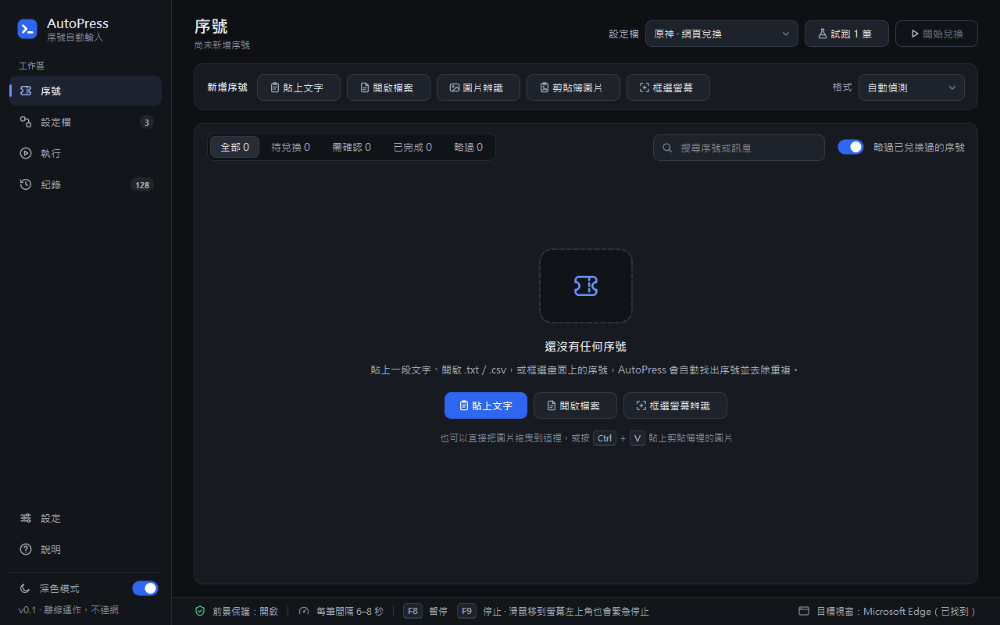
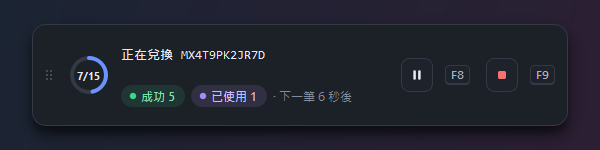

# AutoPress 設計預覽

> [!IMPORTANT]
> **這是「設計預覽」，不是正式版畫面。**
>
> 截圖來自研究階段的靜態原型，**全部是假資料**，功能**尚未實作**；實際畫面與功能以完成版為準。

**AutoPress** 是 Windows 上的遊戲兌換序號自動輸入工具（PyQt6）。把手上的序號一次匯入，它會照你設定的步驟，一筆接一筆自動輸入、送出，並記下每筆結果。通用型，不限定哪一款遊戲。

內容：1 序號頁 · 2 第一次開啟 · 3 淺色模式 · 4 迷你控制列 · 5 其他頁面 · 6 多筆兌換怎麼跑 · 7 安全設計

---

## 1. 序號頁（主畫面）

*圖中是 24 筆假序號：有的已兌換，2 筆辨識信心偏低、需要確認。點圖可放大看細節。*

1. **左側選單**：切換「序號、設定檔、執行、紀錄」四個頁面，右邊數字是數量。左下角另有「設定」「說明」。
2. **設定檔**：選這次要用哪一套兌換流程（對哪個視窗、依序點哪裡、輸入、怎麼判讀結果）。圖中是範例設定檔。
3. **試跑 1 筆／開始兌換**：先拿 1 筆實際跑一次，把讀到的結果訊息和判定並排給你看；沒問題再按「開始兌換」跑整批。開跑前會先出現檢查清單並倒數 3-2-1（規劃中）。
4. **新增序號（5 種方式）**：貼上文字（Ctrl+V）、開啟檔案（.txt／.csv／.json）、圖片辨識（選檔或拖曳）、剪貼簿圖片、框選螢幕（Esc 取消）。圖片類會用 OCR（文字辨識）找出序號，先給你預覽確認（規劃中）。
5. **格式**：預設「自動偵測」序號長相，從文字裡挑出序號；判斷不對可以自己改選。重複的序號會自動去除（標題下方會寫去掉幾筆）。
6. **黃色提示條**：OCR 沒把握時，提醒你有幾筆要檢查（容易認錯的 0／O、1／I、8／B）；可按「逐筆檢查」一筆一筆確認，或按 × 關閉。
7. **狀態分頁**：全部／待兌換／需確認／已完成／略過，一鍵只看某一類；右邊可以搜尋序號或訊息。
8. **略過已兌換過的序號**：打開時，同一款遊戲在紀錄裡已成功或已使用的序號會自動跳過，不會重複送出。
9. **可疑字元＋辨識信心**：從圖片辨識來的序號，可疑字元用黃色標出（第 3、6 列）；「辨識信心」欄用長條和百分比顯示把握程度，偏低的是黃色；貼上或檔案匯入的顯示「—」。序號格可以直接修改，會即時檢查格式。
10. **狀態標籤**：圖中有成功、已使用、需確認、兌換中、待兌換、無效、已過期；「訊息」欄是讀到的結果文字或提示，「來源」欄是這筆從哪裡匯入。
11. **批次操作**：勾選後可一次「移除」「標記為已兌換」「略過」；最右邊「匯出 CSV」，用 Excel 開中文也不會亂碼。
12. **狀態列**：隨時顯示前景保護是否開啟、每筆間隔（6–8 秒）、F8 暫停／F9 停止（滑鼠移到螢幕左上角也會緊急停止）、目標視窗找到了沒。
13. **深色模式**：切換深色／淺色外觀（淺色見第 3 節）。

---

## 2. 第一次開啟（還沒有序號）

- 清單是空的時候，畫面中間直接告訴你怎麼開始：貼上文字、開啟檔案（.txt／.csv）、框選螢幕辨識。
- 也可以把圖片直接拖進來，或按 Ctrl + V 貼上剪貼簿裡的圖片。
- 還沒有序號時，「開始兌換」是灰色的，不能按。
- 第一次啟動還會有歡迎卡片和設定精靈（規劃中，畫面製作中）：
  - 歡迎卡片說明三條原則：只用你自己的序號、網頁兌換比較安全、各遊戲條款由你自己負責。
  - 選範本 → 選目標視窗 → 教它步驟（點一下序號輸入框、指出兌換按鈕、拉出結果訊息出現的範圍、選怎麼關閉結果）→ 試跑預覽 → 用 1 筆實測。
  - 目標是 2 分鐘內設定好。

---

## 3. 淺色模式

同一個畫面的淺色版，功能完全一樣。用左下角的「深色模式」開關切換，設定頁也可以改。

---

## 4. 執行中的迷你控制列

按下開始後，主視窗會縮成這條小控制列：永遠在最上層、可以拖曳（抓左邊的點點），並會避開要點擊的位置和辨識區域。

- 左邊圓圈：進度（圖中第 7 筆／共 15 筆）。
- 「正在兌換」後面是目前這筆序號。
- 結果統計（圖中成功 5、已使用 1），以及「下一筆 6 秒後」。
- 右邊兩個鍵：暫停（F8）、停止（F9）。

---

## 5. 其他頁面（畫面製作中）

這些頁面已有功能定義，但還沒有畫面：

- **設定檔**：設定檔清單、步驟編輯器、內建範本、匯入／匯出。
  - 步驟類型：切換到視窗、點擊位置、點擊文字（OCR）、輸入序號、輸入文字（例如 `/redeem {code}`）、按鍵／組合鍵、等待、等待文字出現、辨識結果。「點擊圖片」排在之後的版本。停止條件（連續失敗幾筆、遇到頻繁限制要停止或冷卻）由設定檔的「執行規則」設定，不是單獨的步驟。
  - 內建範本：網頁兌換（通用）、遊戲內兌換視窗（通用）、HoYoverse 網頁兌換。
  - 分享：匯出成 `名稱.autopress.json`，不含你的序號、紀錄和截圖。匯入時會先檢查內容，用白話列出「此設定檔會：點擊 2 處、輸入序號、按 Enter」再讓你決定存不存；匯入的設定檔不會沿用作者的目標視窗，要你自己選。螢幕解析度不同時，可用「重新對準」把每個位置重新點選一次。
- **執行**：開跑前的檢查清單（找到目標視窗了沒、設定檔測過了沒、共幾筆、間隔、預估時間）、即時紀錄、目前做到哪一步。
- **紀錄**：所有兌換紀錄與結果截圖（證據）、重試失敗項目、匯出 CSV、從紀錄移除。要略過的序號用序號頁的「已略過」篩選，加上「已兌換過的自動跳過」，不另設略過清單。
- **設定**：語言（繁體中文／English）、深淺色、快捷鍵、預設間隔、OCR 引擎（同一個模型就能讀中、英、日文，不必選語言；韓文不支援）、緊急停止、資料夾位置。
- **說明**：安全與遊戲條款、遊戲以系統管理員身分執行時怎麼辦、全螢幕與 DPI 縮放的疑難排解。
- **小視窗**：框選／點選位置用的十字準星（4 倍放大鏡、即時座標）、試跑預覽（在真實視窗上標出編號點位，不送出任何輸入）、3-2-1 倒數、通知訊息。

---

## 6. 一次兌換多個序號是怎麼跑的

以下是規劃中的行為（依 `docs/requirements.md`）。序號清單就是一個**排隊佇列**，依清單順序，每一筆都跑同一套流程：

1. 切到目標視窗，確認它在最前面。
2. 點輸入框 → 清空 → 輸入序號 → 送出。
3. 等結果出現 →（可選）用 OCR 讀結果訊息，判斷成功、已使用、無效、過期等。
4. 關掉結果彈窗 → 記錄 → 等待間隔（固定秒數＋隨機抖動）→ 下一筆。

全部做完自動停止。另外：

- 可以調整順序、只跑勾選的，或只跑還沒完成的。
- 可以暫停／繼續（從下一筆接著做）或停止；程式中途關掉，再開可以從沒做完的那筆繼續。
- 已成功或已使用的自動略過；失敗的可以一鍵重試。
- 出現「操作過於頻繁」這類訊息：停止，或冷卻一段時間後自動繼續（可設定）；連續失敗 N 筆會自動停止。
- 一個序號要分好幾格輸入（例如 `XXXXX-XXXXX-XXXXX` 分三格）：依分隔符號或固定字數拆段，段與段之間送 Tab 或不送。
- 執行中顯示進度（第幾筆／共幾筆、預估剩餘時間）與即時紀錄，結果可以匯出。

**輸入方式（研究結論，實作時可能調整）**

- 預設：一個字一個字送出 Unicode 按鍵。測試程式裡 100% 正確，英數序號不受注音輸入法和 Caps Lock 影響。
- 模式 2：剪貼簿貼上。最快、不受輸入法影響，中文也能輸入。
- 遊戲模式：模擬實體按鍵（虛擬鍵碼＋掃描碼），給只認實體鍵盤的遊戲用。注音輸入法會打亂這種輸入，所以會先暫時關掉目標視窗的輸入法，打完再恢復。

**OCR 文字辨識（研究結論）**

- 使用 RapidOCR＋PP-OCRv6 small 模型、CPU 執行；一個模型就能讀繁中、簡中、英文、日文。模型隨程式附帶，**離線可用、不必下載**。
- 辨識時以你框選的區域為主，而不是整個螢幕。
- 序號圖片測試中完全認對約 80%（Windows 內建 OCR 23%、Tesseract 39%），所以辨識結果一定會讓你確認（第 1 節第 9 點）。

---

## 7. 安全設計

- **只輸入你自己的序號**：AutoPress 不產生、不猜測、不暴力嘗試序號，這類用途刻意不支援。
- **前景保護**：每次按鍵、點擊前都確認最前面的視窗就是目標視窗；不是就立刻停手並暫停，不會打到別的視窗。
- **緊急停止**：F9 停止、F8 暫停／繼續（可以改鍵，刻意不用遊戲常用的 Esc）；滑鼠移到螢幕左上角立刻停止；你一動滑鼠或鍵盤、或切到別的視窗，也會自動暫停。
- **不衝太快**：每筆間隔預設 6–8 秒；看到「操作過於頻繁」立刻停止重試、先冷卻；超過 30 筆開跑前會再確認一次；也可以設每日上限。
- **權限與全螢幕提醒**：遊戲若以系統管理員身分執行，Windows 會默默擋掉輸入，開跑前會先警告；全螢幕截不到畫面時，會建議改用無邊框視窗。
- **資料不離開電腦**：離線運作、不連網、沒有遙測；序號和紀錄只存在你的電腦，分享設定檔時也不會帶出去。
- **誠實提醒**：AutoPress 只是代替你手動輸入序號，但自動輸入是偵測得到的，也有遊戲處罰過巨集。建議優先用網頁兌換；執行中你一動滑鼠或鍵盤就會自動暫停，不會跟你搶著操作。各遊戲條款請自行確認（以上不是法律建議）。

---

**更新紀錄**

- 2026-11-17：依規格 v2 調整——「條件停止」改為設定檔的「執行規則」；「校正」改名「重新對準」（每個位置重新點選）；OCR 不需要選語言；「略過清單」改為「已略過」篩選加上已兌換自動跳過；匯入的設定檔一律要自己選目標視窗。

截圖來源：`docs/research/ux/`，由研究階段的靜態原型 `docs/research/scripts/ux/prototype.py` 產生（1280×800，假資料）。功能定義：`docs/research/ux.md` 第 5 節、`docs/requirements.md`。正式版的「截圖＋說明」會改用實際程式畫面。
