# AutoPress 使用說明

這份說明用 AutoPress 0.1.0 的實際畫面（深色模式、示範資料）一步一步介紹。圖上的橘色數字，對應圖片下方同一個號碼的說明。

- 有圖片的版本在 GitHub：[AutoPress 使用說明（圖文版）](https://github.com/Stardust-mio/AUTOPRESS/blob/main/docs/user_guide.md)。壓縮檔裡附的這份是純文字的 Markdown 檔，用記事本打開看不到圖片。
- 程式裡的「說明」頁（按 F1）也有安全守則、疑難排解與緊急停止的說明。

> [!IMPORTANT]
> **下載後先解壓縮，再執行。** 壓縮檔在 [GitHub Releases](https://github.com/Stardust-mio/AUTOPRESS/releases/latest)：在「Assets」底下點 `AutoPress-<版本>-win64.zip`；不要下載「Source code (zip)」，那是原始碼，裡面沒有 `AutoPress.exe`。下載後在壓縮檔上按右鍵 →「解壓縮全部」，再到解壓縮出來的 `AutoPress-<版本>` 資料夾執行 `AutoPress.exe`。直接在壓縮檔裡按兩下 `AutoPress.exe` 會無法啟動。

解壓縮之後：

- 「解壓縮全部」會建立一個和壓縮檔同名的資料夾，裡面有 `AutoPress-0.1.0` 資料夾和一個提醒檔 `請先解壓縮再執行.txt`；`AutoPress.exe` 在 `AutoPress-0.1.0` 裡。
- 檔案總管沒有顯示副檔名時，`AutoPress.exe` 會顯示成「AutoPress」（類型是「應用程式」）。旁邊的 `_internal` 資料夾是程式的一部分，不要刪掉或搬走。
- 用 WinRAR、7-Zip 等其他解壓縮程式也可以，一樣要先把整個資料夾解壓縮出來再執行。

## 第一次執行：Windows 的安全提醒

AutoPress 沒有付費的程式碼簽章，下載和第一次執行時可能會被擋下來：

- **下載時**：瀏覽器可能提醒這個檔案不常被下載。在瀏覽器的下載清單選擇保留檔案（例如 Edge：在檔案旁按「⋯」→「保留」）。
- **第一次執行時**：出現藍色視窗「**Windows 已保護您的電腦**」時，按「**其他資訊**」，確認「應用程式」是 `AutoPress.exe`，再按「**仍要執行**」。
- **Windows 11 的「智慧型應用程式控制」**：這個功能開著時，沒有程式碼簽章的程式會被直接封鎖，也不會出現「仍要執行」，AutoPress 在這種電腦上沒辦法執行。這個設定在「Windows 安全性」→「應用程式與瀏覽器控制」，要不要關掉請自行判斷。

**防毒軟體跳出警告怎麼辦？** AutoPress 會模擬鍵盤與滑鼠輸入、註冊全域快捷鍵（F8／F9）、擷取螢幕畫面來辨識文字，這些動作和某些惡意程式很像，所以少數防毒軟體可能誤判。AutoPress 不連網、不收集資料、關閉後不留背景程式；完整原始碼公開在 [GitHub 專案頁](https://github.com/Stardust-mio/AUTOPRESS)，可以自行檢查。檔案被隔離時，照這個順序處理：

1. 先從防毒軟體的「隔離區」還原檔案，並把 AutoPress 資料夾加入例外清單。Windows 內建的防毒在「Windows 安全性」→「病毒與威脅防護」→「保護歷程記錄」。
2. 還原不了，再刪掉整個資料夾，重新下載壓縮檔並解壓縮。沒有加入例外的話，重新下載的檔案可能又會被隔離。

只從你信任的來源取得 AutoPress 的壓縮檔，例如上面的 GitHub Releases 頁面。

## 目錄

1. [第一次使用：照這個順序](#第一次使用照這個順序)
2. [第一次開啟](#第一次開啟)：歡迎畫面、左側選單
3. [設定檔與設定精靈](#設定檔與設定精靈)：用範本建立、設定精靈的步驟、「設定檔」頁、修改步驟、重新對準、匯入朋友分享的設定檔
4. [加入序號](#加入序號)：「序號」頁、貼上序號、確認圖片辨識的結果
5. [開始兌換](#開始兌換)：「執行」頁、開始前檢查、迷你控制列、自動暫停與停止、需要你決定時、跑完之後
6. [紀錄、設定與說明](#紀錄設定與說明)：「紀錄」頁、「設定」頁、「說明」頁
7. [疑難排解](#疑難排解)：輸入沒反應、注音輸入法、序號開頭缺字、找不到兌換按鈕、讀不到結果、判讀錯誤、全螢幕、縮放比例、快捷鍵
8. [資料放在哪裡](#資料放在哪裡)：資料資料夾與可攜模式
9. [常見問題](#常見問題)：再次開啟、中途關閉、更新、移除

## 第一次使用：照這個順序

1. 打開 `AutoPress.exe`，在歡迎畫面選好語言與外觀，按「從範本建立設定檔」（見[歡迎畫面](#歡迎畫面)）。
2. 打開遊戲裡的兌換視窗，或官方兌換網頁（要登入的先登入），再選一個範本，按「使用這個範本」（見[用範本建立設定檔](#用範本建立設定檔)）。
3. 照設定精靈選目標視窗、點序號輸入框、框出結果訊息的範圍、選關閉方式。最後一步「用一筆真的序號測試」先按「稍後再說」（見[設定精靈的步驟](#設定精靈的步驟)）。
4. 在「設定檔」頁的「遊戲」欄填上遊戲名稱，按「儲存」（見[「設定檔」頁](#設定檔頁)）。
5. 到「序號」頁加入序號，檢查標成「需確認」的序號（見[加入序號](#加入序號)）。
6. 到「執行」頁先按「測試一筆」，確認序號有正確輸入、結果也判讀對了，再按「開始兌換」（見[開始兌換](#開始兌換)）。
7. 跑完後看結果；每一次兌換嘗試都記在「紀錄」頁（見[跑完之後](#跑完之後)與[「紀錄」頁](#紀錄頁)）。

## 第一次開啟

第一次開啟 AutoPress 會先出現歡迎畫面。

### 歡迎畫面

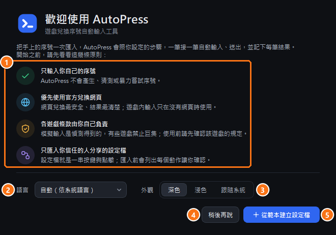

1. 使用前先看這四條原則：只輸入你自己的序號；優先使用官方兌換網頁；有些遊戲禁止巨集，使用前先確認該遊戲的規定；只匯入你信任的人分享的設定檔。
2. 「語言」：預設「自動（依系統語言）」，也可以選「繁體中文」或「English」，選了馬上換。
3. 「外觀」：選「深色」「淺色」或「跟隨系統」。
4. 「稍後再說」：先進入「序號」頁，設定檔之後再建立。
5. 「從範本建立設定檔」：直接到「設定檔」頁挑一個範本開始設定。第一次使用建議按這個。

歡迎畫面只會自動出現一次；想再看，到「設定」頁「歡迎畫面」那一列按「再顯示一次」，下次啟動時會再出現（改用[可攜模式](#資料放在哪裡)後也會再出現一次）。之後要改語言或外觀，到左側選單的「設定」；左下角的「深色模式」開關也能直接切換深淺色。

### 左側選單

關掉歡迎畫面後是 AutoPress 的主視窗：按「從範本建立設定檔」會直接打開「設定檔」頁，按「稍後再說」會打開「序號」頁。下圖是還沒有設定檔、也還沒有序號時的「序號」頁：

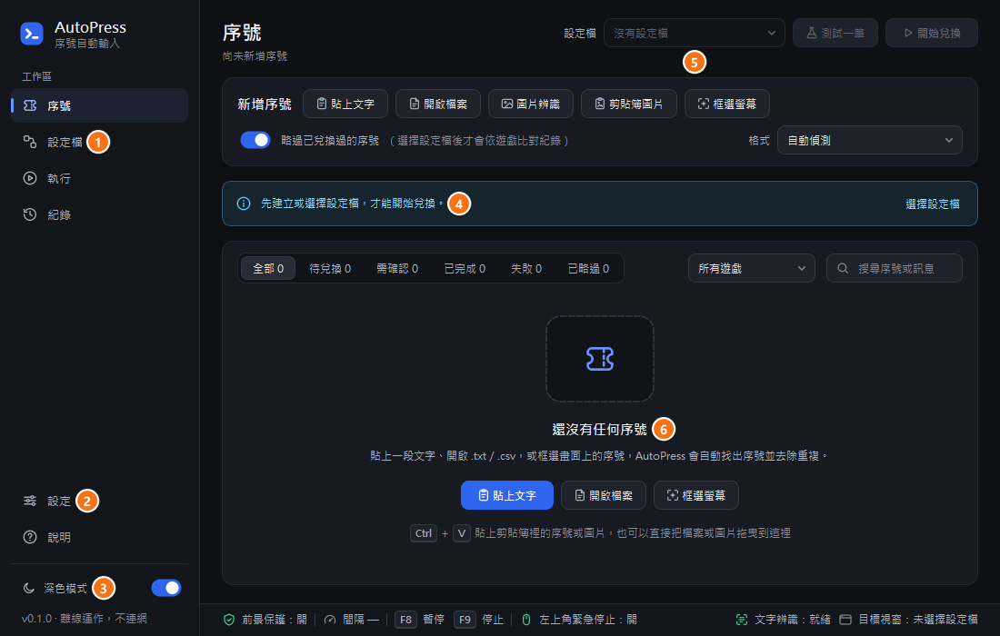

1. 左側選單：「序號」「設定檔」「執行」「紀錄」是平常用的四頁。「設定檔」是兌換流程，通常一款遊戲一個。
2. 「設定」是 AutoPress 本身的偏好（語言、外觀、快捷鍵等），和「設定檔」是不同的頁面；「說明」（F1）有安全守則和疑難排解。
3. 「深色模式」：直接切換深色／淺色。
4. 還沒有設定檔時會出現這個提醒；按右邊的「選擇設定檔」會到「設定檔」頁。
5. 右上角是使用中的設定檔；還沒有設定檔時，「測試一筆」和「開始兌換」按不下去。
6. 還沒有序號時，可以從這裡貼上文字、開啟檔案或框選螢幕；建議先建好設定檔再加序號。

加入序號以後，左側選單「序號」旁邊會顯示還沒處理完的筆數（見[「序號」頁](#序號頁)）。

## 設定檔與設定精靈

設定檔是一套兌換流程：對哪個視窗輸入、依序點哪裡、怎麼輸入序號、怎麼判讀結果。通常一款遊戲（或一個兌換網頁）建一個；按「開始兌換」時，AutoPress 會照標著「● 使用中」的設定檔，一筆一筆輸入序號。

### 用範本建立設定檔

1. 先打開遊戲裡的兌換視窗，或官方兌換網頁（需要登入的先登入）。兌換網頁最好單獨開在一個瀏覽器視窗裡，並且是目前顯示的分頁：AutoPress 用視窗標題認出目標，瀏覽器的視窗標題就是目前分頁的標題。
2. 在歡迎畫面按「從範本建立設定檔」，或在左側選單按「設定檔」。第一次會看到「從範本開始」（見下圖）；之後要再建一個，按「從範本新增」。
3. 選最接近的範本，按「使用這個範本」。
4. 設定精靈會自動開始，照[下一段](#設定精靈的步驟)一步一步做。
5. 精靈結束後，在「遊戲」欄填上遊戲名稱，再按「儲存」。如果你在精靈裡已經貼上序號測試過，儲存時會問「遊戲名稱已變更」，按「移過去」，那些序號就會改屬於這款遊戲。

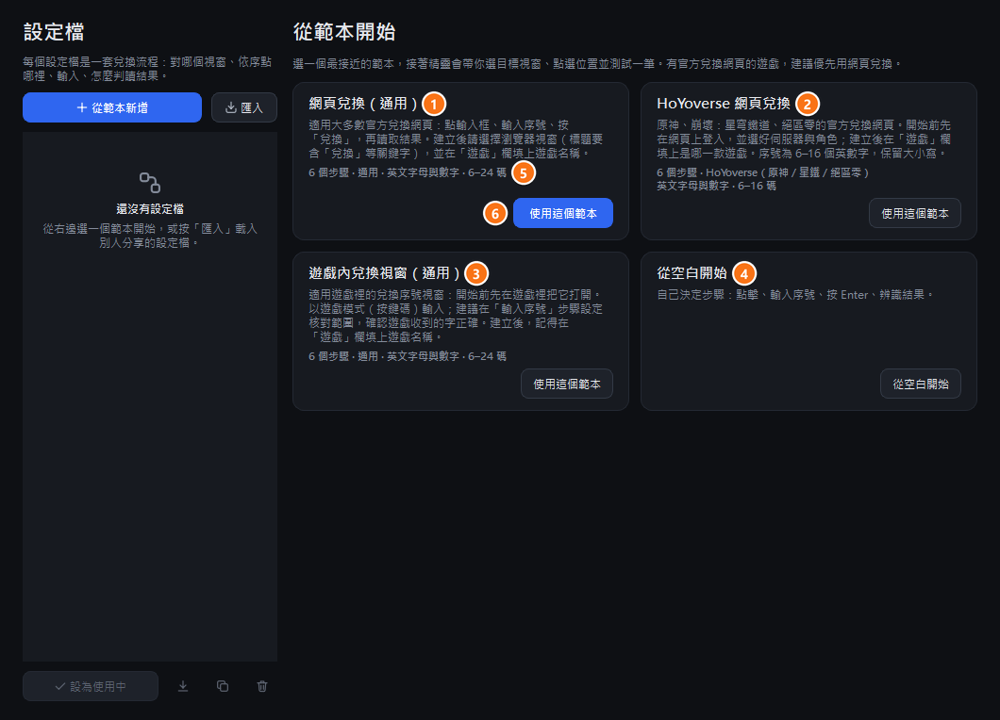

1. 「網頁兌換（通用）」：大多數官方兌換網頁。遊戲有官方兌換網頁時，建議優先用網頁兌換。
2. 「HoYoverse 網頁兌換」：原神、崩壞：星穹鐵道、絕區零的官方兌換網頁。先在網頁上登入，並選好伺服器與角色。
3. 「遊戲內兌換視窗（通用）」：遊戲裡的兌換序號視窗，用「遊戲模式（按鍵碼）」輸入。先在遊戲裡把它打開。
4. 「從空白開始」：只有最基本的步驟（點擊、輸入序號、按 Enter、辨識結果），其他自己在「步驟」裡調整。
5. 每個範本有幾個步驟，以及預設的序號格式（可用的字元與長度）。
6. 選好後按「使用這個範本」，設定精靈就會開始。

只有在還沒有任何「使用中」的設定檔時，新建立的設定檔才會自動變成使用中。建第二個以後，要用它兌換，就在「設定檔」頁選取它，再按「設為使用中」。

### 設定精靈的步驟

每個精靈視窗上方都會顯示進度，例如「設定精靈 1/5」。用範本建立時通常是下面 5 個畫面；要設定的項目越少，畫面越少。精靈隨時可以取消（選視窗時按「取消」，其他步驟按「取消精靈」），已完成的部分會保留；沒設好的項目會列在「設定檔」頁上方的「設定檢查」，按旁邊的「設定」就能補上。

> [!NOTE]
> 下面的精靈截圖是用已經選好目標視窗的示範設定檔拍的，所以進度寫的是 1/4、3/4、4/4，選擇目標視窗的截圖上方也沒有進度。第一次用範本設定時，選擇目標視窗是「設定精靈 1/5」，後面的畫面依序是 2/5 到 5/5。

**第 1 個畫面：選擇目標視窗。** 從清單選要輸入序號的視窗。

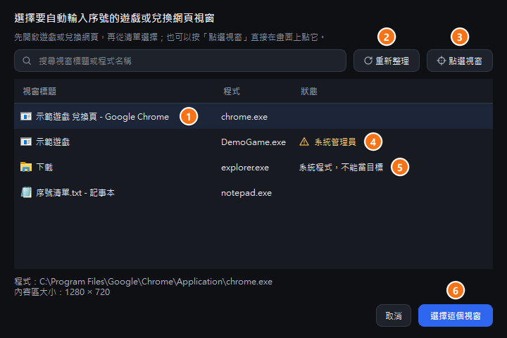

1. 從清單選出要輸入序號的視窗：兌換網頁選那個瀏覽器視窗（先切到兌換網頁的分頁，清單顯示的是目前分頁的標題），遊戲內兌換選遊戲本身。
2. 清單裡沒有？先打開遊戲或兌換網頁，再按「重新整理」。
3. 也可以按「點選視窗」，直接在畫面上點一下目標視窗。
4. 「系統管理員」：這個遊戲以系統管理員身分執行，Windows 會擋下 AutoPress 的輸入。選取它後，左下角會出現「以系統管理員身分重新啟動」，按下並允許後再選一次；帳戶沒有管理員權限時，請改用網頁兌換。
5. 標著「系統程式，不能當目標」的視窗不能選。
6. 選好後按「選擇這個視窗」。選的是瀏覽器時，下一步「確認視窗標題的關鍵字」可以縮短（例如只留「兌換」），但不能留空。

**第 2 個畫面：點選位置。** 精靈會告訴你要點哪裡，例如「點一下序號輸入框」。

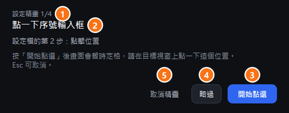

1. 進度：第幾個畫面／一共幾個。要設定的項目越少，畫面越少（這張圖是 1/4）。
2. 這次要記錄的位置，下一行寫著它是設定檔的第幾步。
3. 按「開始點選」後畫面會暫時定格，在目標視窗上點一下那個位置；按 Esc 取消，可以再點一次。
4. 「略過」：先不設定。沒設好的會列在「設定檔」頁上方的「設定檢查」，之後按「設定」補上。
5. 「取消精靈」：結束精靈，已經記錄的位置會保留。

**第 3 個畫面：框出結果訊息的範圍。** 按「開始框選」後畫面會暫時定格，按住滑鼠拖曳，框住兌換後會出現結果訊息的地方。還沒兌換過、不知道訊息會出現在哪裡時，框大一點，例如整個兌換區塊，連輸入框上下都框進去：框裡原本就有的字（標題、說明、剛輸入的序號）會被略過，AutoPress 只讀按下「兌換」後新出現的文字。框錯了也沒關係，之後可以用「重新對準」重新框選（見[疑難排解](#疑難排解)）。

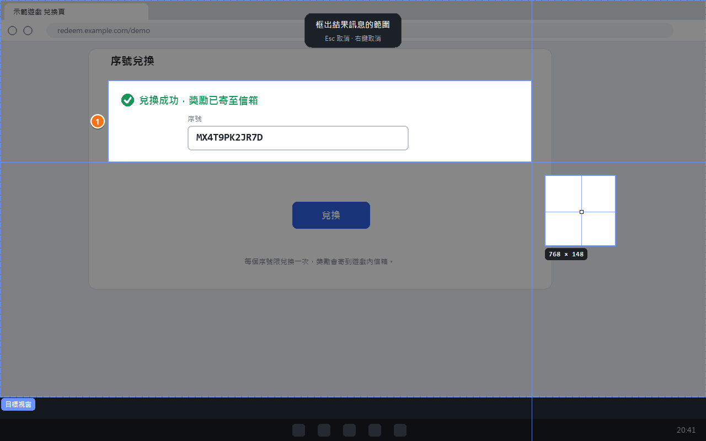

1. 按住滑鼠拖曳框出範圍。框大一點，把訊息可能出現的整片區域都框進去（這裡連輸入框一起框）；框裡原本就有的字會被略過，AutoPress 只讀按下「兌換」後新出現的文字。圖中的訊息只是示範，設定時畫面上通常還沒有訊息。

**第 4 個畫面：選擇結果視窗的關閉方式。** 三選一，再按「下一步」。

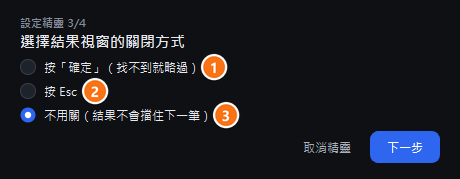

1. 兌換後會跳出結果視窗、要按「確定」或「OK」才會關掉時選這個；沒跳出來時，這一步會自動略過。
2. 結果視窗要按 Esc 鍵才會關掉時選這個。
3. 結果直接顯示在頁面上、不會擋住輸入框時選這個。

**第 5 個畫面：用一筆真的序號測試。** AutoPress 先在目標視窗上標出剛才記錄的位置（約 6 秒），接著問你要不要測試。照[第一次使用](#第一次使用照這個順序)的順序，這時還沒加入序號，請先按「稍後再說」。

1. 精靈的最後一步。清單裡已經有這款遊戲的「待兌換」序號時，會拿第一筆來測試（圖中的情況）；還沒有時，這裡會改成一個輸入框，可以貼上一筆序號。
2. 「稍後再說」：還沒加入序號、還沒填「遊戲」時先按這個；之後在「執行」頁或「序號」頁按「測試一筆」。
3. 「測試一筆」：會真的兌換這一筆。先跳出「開始前檢查」、倒數 3 秒，主視窗再縮成迷你控制列（F8 暫停、F9 停止）。

### 「設定檔」頁

精靈結束後，可以在「設定檔」頁檢查或修改設定：

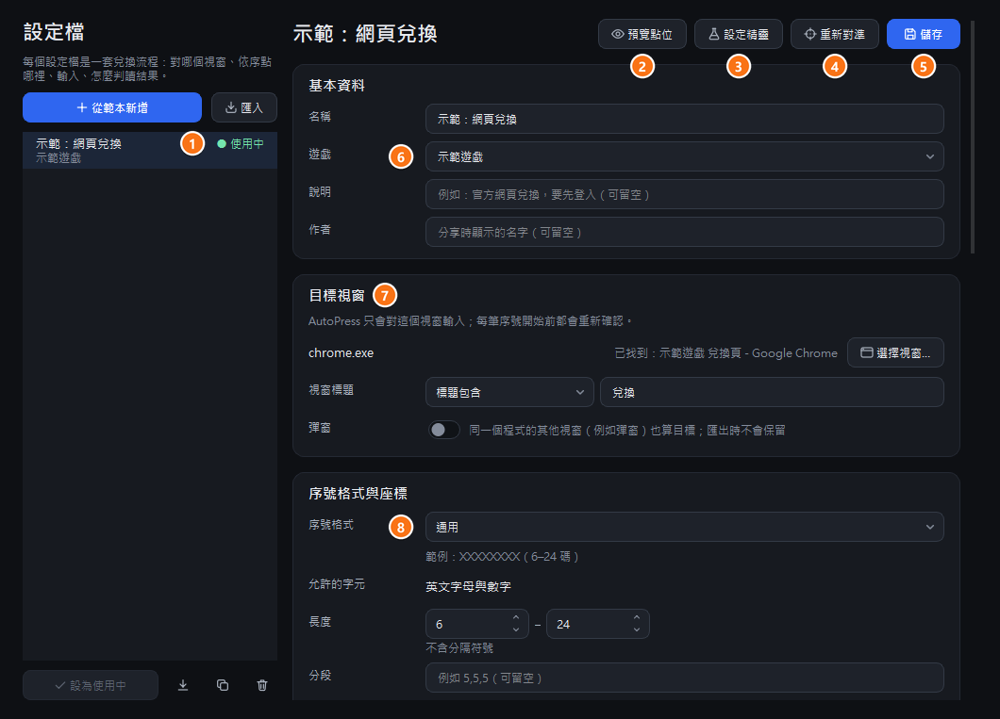

1. 你的設定檔清單。標「● 使用中」的就是開始兌換、加入序號時用的設定檔；要換，選取另一個再按左下角的「設為使用中」（「序號」頁右上角也能換）。
2. 「預覽點位」：在目標視窗上標出記錄的每個位置（約 6 秒），確認有沒有對準。
3. 「設定精靈」：再開一次精靈，補上還沒設定的項目，最後測試一筆。
4. 「重新對準」：視窗大小或 Windows 縮放比例改變後，把每個位置重新點選一次。
5. 「儲存」：在這一頁改了設定要按「儲存」（Ctrl+S）；精靈每完成一步會自動儲存。
6. 「遊戲」：這個設定檔用在哪一款遊戲。同一款遊戲的序號與紀錄會放在一起，用範本建立後記得填。
7. 「目標視窗」：AutoPress 只會對這個視窗輸入。顯示「已找到」表示它現在開著；要換視窗按「選擇視窗…」。瀏覽器還要在「視窗標題」填關鍵字（例如「兌換」），以免輸入到別的分頁。
8. 「序號格式」：這款遊戲的序號長什麼樣子（可用的字元、長度）。範本已經選好；遊戲有專屬格式時可以從清單改選。

往下捲還有三個區塊：

- 「步驟」：每筆序號都會依序執行這些步驟，左邊選步驟、右邊改設定。見下一段[修改步驟](#修改步驟)。
- 「執行規則」：每筆之間的間隔（預設 6–8 秒）、遇到「操作過於頻繁」怎麼辦、什麼時候自動停止。不確定就保持預設。
- 「結果關鍵字」：讀到的訊息含哪些字，算哪一種結果（「操作過於頻繁」「已使用」「已過期」「無效」「不符資格（伺服器／等級／上限）」「成功」）。每一類可以填好幾個，用逗號分隔；比對時忽略大小寫、空白與標點，由上往下，第一個符合的類別算數；但符合「成功」的訊息如果也符合其他類別，或還有「失敗」「無法」這類否定的字（例如「未能成功兌換」），會當成無法判讀，停下來問你。在「執行」頁按「加入關鍵字…」加的字也存在這裡。「測試一筆」判錯時（例如網頁說兌換成功，AutoPress 卻判成「無效」），就在這裡改：把造成誤判的字從錯的類別刪掉，把訊息裡的關鍵字加到正確的類別，再按「儲存」。「還原預設」會換回 AutoPress 預設的關鍵字。

### 修改步驟

範本的步驟大多不用改。遇到下面這些情況，才需要到「步驟」區塊修改，改完按「儲存」，再用「測試一筆」確認。

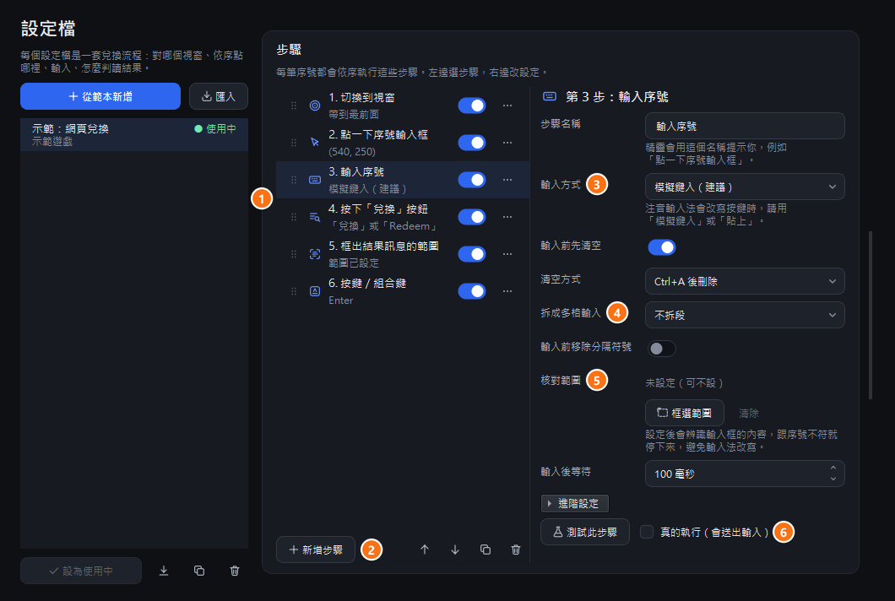

1. 步驟清單：每筆序號都會從上到下做一次這些步驟。點選一步，右邊就顯示它的設定；右邊的開關可以暫時停用這一步。
2. 「新增步驟」：選一種步驟加進清單，例如「輸入文字」「按鍵／組合鍵」。右邊的箭頭調整順序，也可以複製或刪除選取的步驟。
3. 「輸入方式」：「模擬鍵入（建議）」「貼上（剪貼簿）」或「遊戲模式（按鍵碼）」，怎麼選見下方。
4. 「拆成多格輸入」：一個序號要分好幾格填時，選「依分隔符號拆段」或「依固定字數拆段」。
5. 「核對範圍」：按「框選範圍」框住序號輸入框；輸入後 AutoPress 會讀回框裡的字，和序號不符就不送出，這一筆記為「失敗」。
6. 「測試此步驟」：預設只找位置、讀文字，不送出輸入，結果顯示在下方（例如讀到的文字）；勾「真的執行（會送出輸入）」才會真的點擊或打字。

**三種輸入方式**（「輸入序號」步驟的「輸入方式」）：

- 「模擬鍵入（建議）」：一個字一個字送出序號的字元。大多數網頁和程式都適用，注音輸入法和 Caps Lock 改不到這些字。
- 「貼上（剪貼簿）」：把序號放進剪貼簿再按 Ctrl+V，貼完會還原剪貼簿原本的內容。輸入框不接受貼上時不能用。
- 「遊戲模式（按鍵碼）」：模擬按下實體按鍵，給只認實體按鍵的遊戲用；輸入時會暫時關閉目標視窗的輸入法。只能輸入鍵盤上有的字。

**核對範圍**（建議遊戲內兌換時設定）：選「輸入序號」步驟，在「核對範圍」按「框選範圍」，框住序號輸入框，再按「儲存」。之後每次輸入完，AutoPress 會先讀回輸入框裡的字，和序號不符就不送出，那一筆記為「失敗」，訊息寫著「輸入內容與序號不符」。

**按鈕上的字不是「兌換」**（例如「立即兌換」「領取」）：網頁範本的「按下「兌換」按鈕」步驟，只會點字跟「要點擊的文字」完全相同的按鈕（「網頁兌換（通用）」的預設是 `兌換|兑换|Redeem|Submit|送出|確認|确认|Confirm`，「HoYoverse 網頁兌換」是 `兌換|兑换|Redeem|交換`）。選這一步，在「要點擊的文字」最後加上 `|` 和按鈕上的字，例如 `|立即兌換`。按「測試此步驟」可以看到它實際讀到的文字。

**用聊天指令兌換**（例如輸入 `/redeem 序號` 再按 Enter）：

1. 按「新增步驟」→「輸入文字」，在「要輸入的文字」填 `/redeem {code}`；`{code}` 會換成每一筆序號。
2. 用箭頭把它移到原本「輸入序號」的位置，再關掉「輸入序號」步驟的開關。
3. 後面要有一個「按鍵／組合鍵」步驟，「按鍵或組合鍵」填 `Enter`（「從空白開始」的設定檔已經有這一步）。

這樣設定後，「開始前檢查」會提醒「沒有「輸入序號」步驟，序號不會被輸入」；序號其實由 `{code}` 輸入，看過後勾選「我已了解上面的提醒」即可。指令打錯時，序號會直接發到聊天頻道，請先用「測試一筆」確認。

**一個序號要分好幾格填**（例如 `XXXXX-XXXXX-XXXXX` 分三格）：在「輸入序號」步驟的「拆成多格輸入」選「依分隔符號拆段」（序號裡有 `-` 時）或「依固定字數拆段」（在「每段字數」填例如 `5,5,5`）；「段與段之間」選「段與段之間按 Tab」，輸入框會自己跳到下一格的頁面選「不按（輸入框會自動跳格）」。「點一下序號輸入框」要點第一格。

### 位置跑掉時：重新對準

點擊位置是跟著目標視窗記錄的，視窗搬到別的地方也沒關係。但下面這些情況，位置可能偏掉：

- 視窗大小或 Windows 縮放比例（例如 100% 改成 125%）和設定時不同。視窗搬到縮放比例不同的另一個螢幕，也算縮放比例改變。這兩種情況「開始前檢查」都會提醒你。
- 兌換網頁被放大或縮小（例如按住 Ctrl 轉滾輪），或設定後把網頁往下捲了。這種情況 AutoPress 看不出來：請把網頁縮放改回 100%、捲回設定時的位置。

處理方式：

1. 按「預覽點位」，看標記有沒有落在正確的位置。
2. 不準就按「重新對準」，依序重新點選每個位置；還準的位置按「保留原位置」。

### 匯入朋友分享的設定檔

設定檔就是一串按鍵與點擊，只匯入你信任的人分享的設定檔。

1. 在「設定檔」頁按「匯入」，選擇設定檔（副檔名 `.autopress.json`）；也可以直接把檔案拖進「設定檔」頁。
2. 逐行看過它會做的動作（見下圖），沒問題才匯入。若還列出「與預設不同的執行規則」，也要一起看。
3. 匯入後，精靈會請你選擇自己的目標視窗，再設定或確認每個位置。

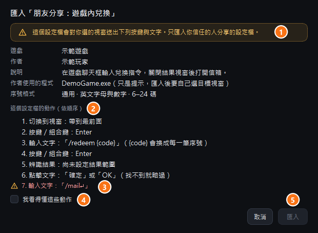

1. 先看這段提醒：設定檔會對你選的視窗送出下面這些按鍵與文字，只匯入你信任的人分享的設定檔。
2. 「這個設定檔的動作（依順序）」：每一筆序號都會照這個順序做一次，請逐行看過；「{code}」會換成你的每一筆序號。
3. 前面有警告圖示（⚠）的那一行要特別注意：它可能切換分頁、開網址列，或每次都輸入同樣的文字。這裡每一筆都會輸入「/mail」，「↵」是換行，效果等於按 Enter。
4. 全部看懂後，勾選「我看得懂這些動作」，「匯入」才按得下去。
5. 按「匯入」後會自動開啟設定精靈：先選你自己的目標視窗，再設定或確認每個位置。

要分享自己的設定檔：選取它，按清單下方的匯出圖示（滑鼠移上去會顯示「匯出」）。分享的檔案不含你的序號、紀錄和截圖，也不含完整的視窗標題；匯出時可以留一個簡短的標題關鍵字（例如「兌換」），但不要填帳號或角色名稱。

## 加入序號

序號要先加進「序號」頁的序號清單（程式裡有些地方叫「佇列」，例如「重新加入佇列」），才能兌換。加入的序號屬於使用中的設定檔的遊戲，所以先照上一節建好設定檔、填好「遊戲」，再加序號。

> [!TIP]
> 沒有設定檔時也能加序號，但這些序號還不屬於任何遊戲；建好設定檔後，「序號」頁會出現「… 筆序號尚未指定遊戲，這次不會執行。」，按這一列的「指定給」按鈕（後面接著遊戲名稱）就好。

### 「序號」頁

右上角可以切換使用中的「設定檔」；「測試一筆」和「開始兌換」等設定檔準備好再按。還沒有序號時，頁面中間會顯示「還沒有任何序號」；還沒有設定檔時，上方會提醒「先建立或選擇設定檔，才能開始兌換。」

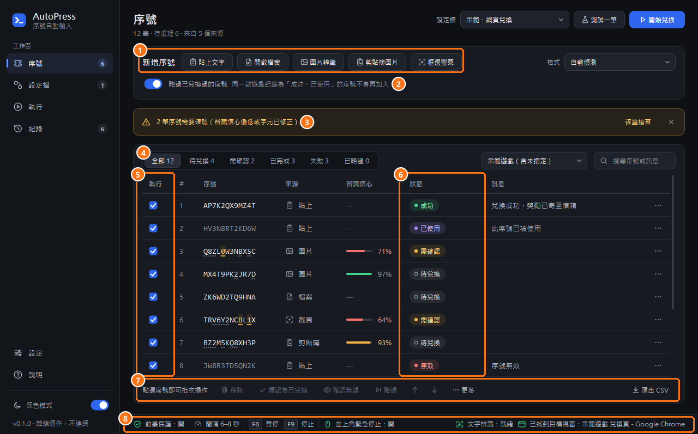

1. 「新增序號」：「貼上文字」（或直接按 Ctrl+V）和「開啟檔案」從文字找序號；「圖片辨識」「剪貼簿圖片」「框選螢幕」從圖片找序號。檔案和圖片也可以直接拖到這一頁。同一列最右邊的「格式」通常不用改。
2. 「略過已兌換過的序號」：開著時（預設），同一款遊戲紀錄裡已經「成功」或「已使用」的序號，不會再加進清單。
3. 有序號需要確認時才會出現這一列；序號裡標出來的字元，就是辨識時不太確定的字。按「逐筆檢查」會依序選到每一筆「需確認」的序號：和原本的圖片或公告對照沒錯，就按下方的「確認無誤」，它會改回「待兌換」；不對就雙擊序號修改。
4. 篩選：點「全部」「待兌換」「需確認」「已完成」「失敗」「已略過」只看那一類（數字是筆數）；右邊可以依遊戲篩選，或搜尋序號和訊息。
5. 「執行」欄的勾選：只有在「執行」頁選了「只跑勾選的」才有作用。預設的「全部未完成」會兌換這個遊戲所有「待兌換」的序號，有沒有勾都一樣；已經有結果的序號（例如「成功」「已使用」）就算勾著也不會再兌換。
6. 「狀態」：「待兌換」是還沒兌換；「需確認」要你先確認，確認前不會兌換；兌換後會變成「成功」「已使用」「無效」「已過期」或「失敗」等。右邊的「訊息」是兌換後讀到的結果或失敗原因。
7. 批次操作：先點選序號（按住 Ctrl 或 Shift 可以多選），再按「移除」「標記為已兌換」「確認無誤」「略過」，或用上下箭頭調整順序；「更多」裡還有「重試失敗」「清除已完成」等。最右邊的「匯出 CSV」把目前列出的序號存成 Excel 可以開啟的檔案。
8. 狀態列：「前景保護：開」表示每次輸入前都會確認目標視窗在最前面，不是就暫停；「間隔」是每筆之間等幾秒；執行中按 F8 暫停、F9 停止，或把滑鼠推到螢幕最左上角緊急停止。右邊顯示文字辨識是否就緒、有沒有找到目標視窗。

這一頁還有幾個數字和記號：

- 標題的「待處理」是還沒處理完的序號：「待兌換」（含兌換中、冷卻中）加上「需確認」，左側選單「序號」旁的數字也是這樣算的。「執行」頁的「未完成」只算現在就能兌換的「待兌換」序號；「需確認」的要你先確認，才會兌換。
- 「辨識信心」欄只有從圖片辨識的序號才有：長條越短、百分比越低，越可能認錯字，請和原圖對照。從文字加入的序號顯示「—」。
- 序號裡有虛線底線的字，是容易看錯的字（例如 0 和 O、1 和 I）；底色標出來的字則是辨識時不太確定、要你確認的字。

### 貼上序號

1. 複製含有序號的文字，例如官方公告或直播聊天室的內容。
2. 在「序號」頁按「貼上文字」，或直接按 Ctrl+V。
3. 「貼上序號」視窗會列出找到的序號（見下圖），確認後按右下角的「加入 N 筆」（N 是要加入的筆數）。

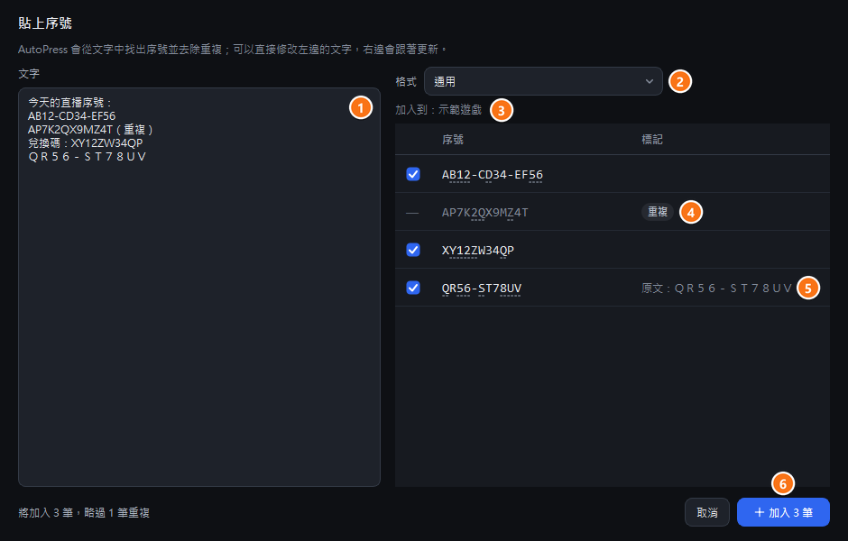

1. 「文字」：貼上的文字，可以直接修改；右邊的清單會跟著更新。
2. 「格式」：序號被切錯或混進其他文字時，改選你的遊戲格式；通常不用改。
3. 「加入到」：這些序號會屬於哪一款遊戲，也就是使用中的設定檔（「序號」頁右上角選的那個）的遊戲。還沒有設定檔時，序號會先加入「未指定遊戲」。
4. 「重複」：這個序號已經在清單裡，不會再加入。標「已兌換過」的也不會加入；標「不像序號」的預設不勾選，確定是序號再勾起來。
5. 全形字會自動轉成半形，旁邊的「原文：…」是原本的樣子。
6. 左下角寫著會加入幾筆、略過幾筆；只會加入有勾選的序號。確認後按「加入 N 筆」（N 是要加入的筆數）。

用「開啟檔案」讀進的 .txt、.csv 等序號清單，也會先開同樣的視窗讓你確認。

### 確認圖片辨識的結果

序號在圖片裡時（例如直播截圖），用這三個按鈕加入：

- 「圖片辨識」：選一張圖片；也可以直接把圖片拖到「序號」頁。
- 「剪貼簿圖片」：先按 Win+Shift+S 截圖，再按這個按鈕；在「序號」頁按 Ctrl+V 也可以。
- 「框選螢幕」：AutoPress 會暫時隱藏，用滑鼠框出畫面上有序號的區域，按 Esc 取消。

辨識完會開啟確認視窗，看過再加入：

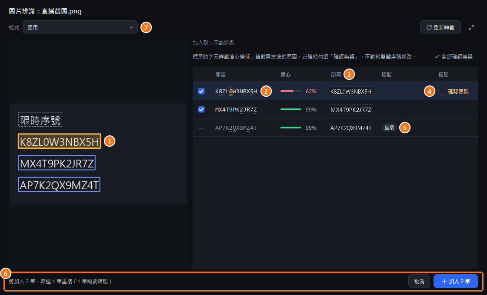

1. 左邊是你的圖片：藍框是找到的序號，黃框是有字元不太確定、要你確認的序號，虛線框是不像序號的文字。滾輪可以放大縮小，連按兩下回到整張圖。
2. 序號裡標出來的字元（這筆是「0」）是辨識時不太確定的字，例如 0 和 O、1 和 I 很像；有虛線底線的字也容易看錯。不對就雙擊序號直接修改。
3. 「原圖」：從圖片裁下來的那一行，方便和同一列的序號逐字對照。
4. 對照沒錯就勾選「確認無誤」；有很多筆時可以按右上方的「全部確認無誤」（請先逐筆看過）。沒勾的會以「需確認」加入清單，確認之前不會兌換。
5. 「重複」：這個序號已經在清單裡，不會再加入一次。
6. 下方寫著這次會加入幾筆、略過幾筆；只會加入最左邊有勾選的序號。沒問題就按「加入 2 筆」。
7. 「格式」：序號被切錯或混進其他文字時，改選你的遊戲格式；還是不對就按右上角的「重新辨識」再讀一次圖片。

## 開始兌換

在左側選單點「執行」，照這個順序做：

1. 第一次在某個遊戲或兌換網頁使用時，先按「測試一筆」（這一筆會真的兌換），確認序號有正確輸入、結果也判讀對了。
2. 按「開始兌換」，會先跳出「開始前檢查」視窗：標 ✕ 的問題要先處理才能開始；有提醒時，勾選「我已了解上面的提醒」再按「仍要開始」。一次超過 30 筆會再問你一次。
3. 畫面中央倒數 3、2、1，請放開滑鼠、別碰鍵盤。倒數時按 F9 可以取消；畫面左上角的箭頭指著「緊急停止」的位置。
4. 主視窗收起來，只留下迷你控制列（它會自己避開要點的位置）。AutoPress 一筆接一筆輸入、送出、讀結果，每筆之間預設隔 6–8 秒。
5. 全部做完或停止後，主視窗回到「執行」頁，最上方顯示這次的結果（見[跑完之後](#跑完之後)）。

「測試一筆」走的也是同樣的流程，只是只跑一筆：清單裡第一筆「待兌換」的序號（照「序號」頁「#」欄的順序，有沒有勾選都一樣）。想測某一筆，在「序號」頁點選它，再按同一頁右上角的「測試一筆」；或選取它後按「更多」→「移到最上」。

### 「執行」頁

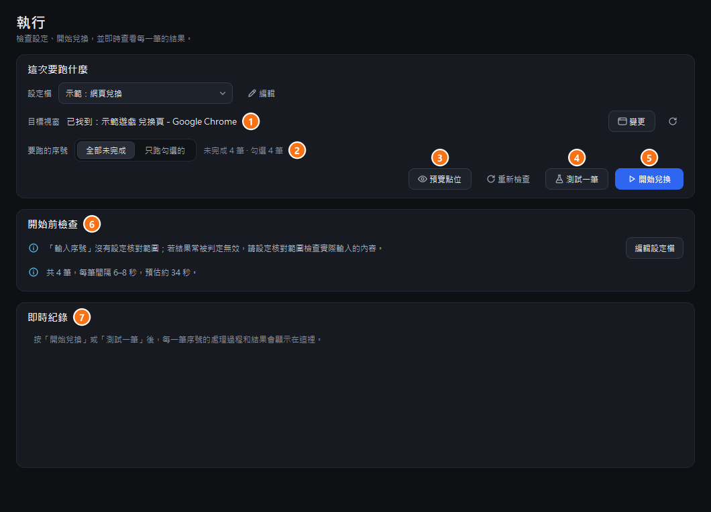

1. 「設定檔」是這次要用的遊戲設定，「目標視窗」要顯示「已找到：…」。找不到時，先開啟遊戲或兌換網頁，再按右邊的重新整理鈕；或按「變更」重新選擇視窗。
2. 「全部未完成」會跑這個遊戲所有「待兌換」的序號（「需確認」的要先確認），「只跑勾選的」只跑其中你在「序號」頁勾選的；右邊顯示各有幾筆。
3. 「預覽點位」：在遊戲或兌換網頁上標出每一步要點的位置和要讀的範圍，確認沒有偏掉。
4. 「測試一筆」：只拿清單中第一筆「待兌換」的序號跑一次完整流程（有沒有勾選都一樣），這一筆會真的送出兌換。第一次在某個遊戲或網頁使用時先按它，確認序號有正確輸入、結果也判讀對了；還沒測試成功前，「開始前檢查」會一直提醒你。
5. 「開始兌換」：整批開始。會先跳出「開始前檢查」視窗，再倒數 3 秒。
6. 「開始前檢查」：標 ✕ 的是必須先處理的問題，三角形是提醒，圓圈 i 只是資訊。右邊的按鈕（例如「編輯設定檔」）可以直接去處理，處理完按上方的「重新檢查」；最後一行是預估要花的時間。按「開始兌換」或「測試一筆」時，同一份清單會再跳出來一次。
7. 「即時紀錄」：開始後，每一筆的處理過程和結果會即時列在這裡。

### 開始前檢查

按「開始兌換」或「測試一筆」時，會跳出和「執行」頁同一份的「開始前檢查」清單，確認後才開始：

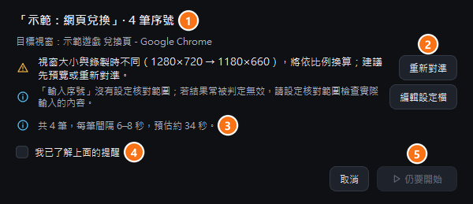

1. 這次用哪個設定檔、要跑幾筆；下一行是找到的目標視窗。按「測試一筆」時，視窗標題是「測試一筆：開始前檢查」。
2. 三角形是提醒：可以先按右邊的按鈕處理（這裡是「重新對準」），也可以了解後照樣開始。標 ✕ 的問題一定要先處理，這時只能按「關閉」。
3. 圓圈 i 是資訊；最後一行是筆數、間隔與預估時間。
4. 有提醒時，先勾選「我已了解上面的提醒」，「仍要開始」才按得下去。
5. 「仍要開始」（沒有提醒時是「開始兌換」，測試時是「開始測試」）：接著倒數 3 秒，請放開滑鼠、別碰鍵盤。按「取消」就不開始。

### 執行中：迷你控制列

執行時畫面上只有這條控制列。圖中三條是同一條控制列在三種時候的樣子：執行中、自動暫停、冷卻中。右邊三顆按鈕只有圖示，滑鼠移上去會顯示名稱。

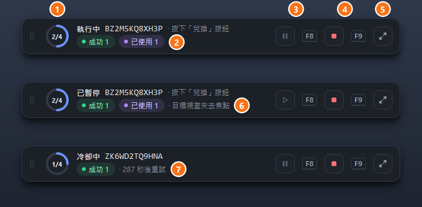

1. 進度圈是已處理幾筆（2/4＝4 筆中已處理 2 筆），旁邊是狀態（「執行中」）、正在處理的序號和步驟。按住最左邊的點點可以拖曳控制列。
2. 到目前為止的結果，每種各有幾筆（例如「成功 1」「已使用 1」）。
3. ⏸ 暫停鈕（滑鼠移上去會顯示「暫停（F8）」）：按它或按 F8 暫停。暫停後它變成 ▷ 繼續鈕，再按一次或按 F8 就接著做。旁邊的「F8」「F9」標出目前的快捷鍵。
4. ■ 停止鈕（提示「停止（F9）」）：按它或按 F9 結束這次執行。
5. 展開鈕（提示「展開主視窗（會先暫停）」）：先暫停，再打開主視窗的「執行」頁，可以看詳細進度和「即時紀錄」。
6. 自動暫停時，狀態變成「已暫停」，後面寫著原因（這裡是「目標視窗失去焦點」：遊戲或兌換網頁被切到後面）。切回去後按「繼續」或 F8，倒數 2 秒後接著做。
7. 「冷卻中」：兌換頁回覆「操作過於頻繁」，AutoPress 先等一段時間（預設 300 秒）再重試同一筆，這裡顯示還剩幾秒。

### 自動暫停與停止

- F8 暫停／繼續、F9 停止：只在執行中有效，可以在「設定」頁更換。
- 緊急停止：把滑鼠推到螢幕最左上角，會立刻停止（有多個螢幕時，「設定」頁會寫出是哪一個角）。會鎖住滑鼠的遊戲請改按 F9。
- 你一動滑鼠或鍵盤，AutoPress 會在下一次輸入或點擊之前暫停，以免打到別的地方；遊戲或兌換網頁被切到後面時也會暫停。處理好後按「繼續」或 F8。
- 兌換頁出現「操作過於頻繁」這類訊息時，預設冷卻 300 秒後重試同一筆；同一次執行再遇到就停止。
- 連續 3 筆「失敗」或「需確認」會自動停止。連續 3 筆「無效」會暫停：可能是輸入方式不對（例如輸入法、大小寫），請用「測試一筆」看看輸入框裡的序號對不對。
- 這些秒數和筆數可以在「設定檔」頁的「執行規則」調整。

### 需要你決定時

讀不懂兌換結果、連續多筆被判定無效、切換了分頁或找不到遊戲視窗時，執行會暫停，主視窗跳回「執行」頁等你處理。

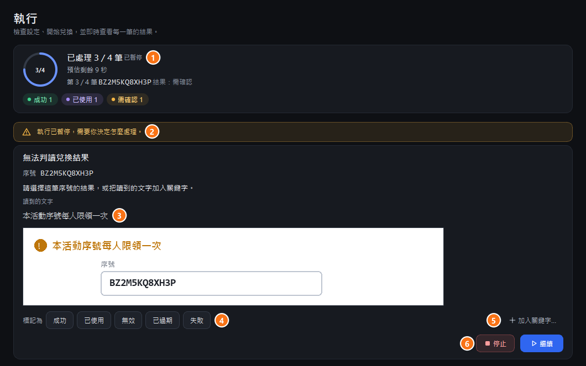

1. 執行進度：「已處理 3 / 4 筆」、狀態（「已暫停」）、預估剩餘時間，以及目前這一筆的序號和結果。下面的標籤是到目前為止的結果。
2. 執行已暫停，主視窗自動回到「執行」頁。下面的標題是原因，這裡是「無法判讀兌換結果」：讀到的訊息對不上設定檔裡的任何關鍵字，AutoPress 不確定這筆算成功還是失敗。
3. 「讀到的文字」和兌換頁結果區的截圖，讓你自己判斷這筆的結果。
4. 判斷好後，在「標記為」後面按對應的結果：「成功」「已使用」「無效」「已過期」或「失敗」。
5. 「加入關鍵字…」：選這段文字代表哪種結果，存進設定檔，這一筆也會一起標記。以後看到同樣的訊息就會自動判定，不用再停下來問你。
6. 按「繼續」接著做下一筆（先倒數 2 秒）；沒標記就繼續的話，這筆會保留「需確認」，跑完後再處理（見下方「跑完之後」）。按「停止」結束這次執行。

### 跑完之後

主視窗回到「執行」頁，最上方顯示「執行結束：…」、這次處理了幾筆，以及每種結果各有幾筆。

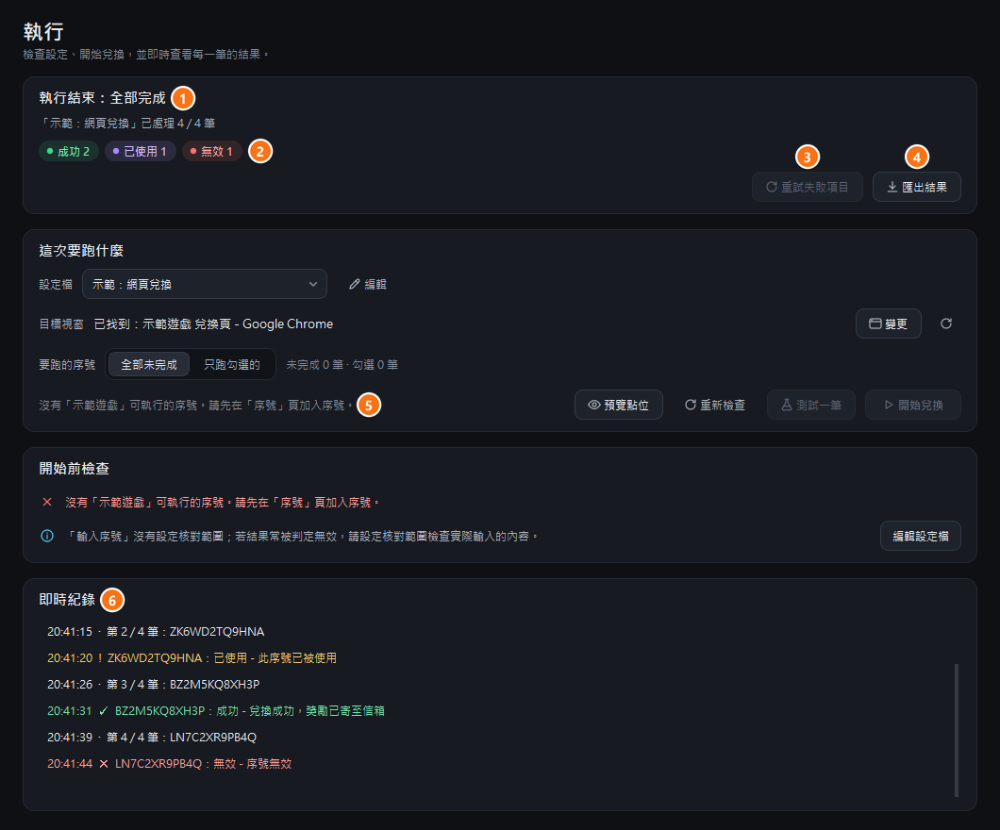

1. 「執行結束：…」寫著這次怎麼結束的，例如「全部完成」「使用者停止」「連續失敗次數過多，已停止」。
2. 這次處理了幾筆，以及每種結果各有幾筆。
3. 「重試失敗項目」：把清單裡「失敗」的序號都改回「待兌換」，再按「開始兌換」就會重跑；這次沒有失敗時是灰色的。
4. 「匯出結果」：把這次的結果存成 CSV 檔，可以用 Excel 開啟。
5. 序號都跑完了，所以「測試一筆」和「開始兌換」是灰色的；在「序號」頁加入新的序號後才能再開始。
6. 「即時紀錄」留著這次每一筆的過程和結果；每一次嘗試的完整紀錄在「紀錄」頁。

跑完後還是「需確認」的序號（讀不懂結果，或送出後被中斷），可能其實已經兌換成功了。不要直接重跑，先處理：

1. 到遊戲裡（例如信箱、兌換紀錄）確認這個序號有沒有兌換成功。
2. 已經成功的：在「序號」頁選取它，按「標記為已兌換」，以後就不會再輸入。
3. 確定沒有成功送出的：選取它，按「確認無誤」，它會回到「待兌換」，下次「開始兌換」時再試。

## 紀錄、設定與說明

### 「紀錄」頁

每一次兌換嘗試都會記在左側選單的「紀錄」頁。之後匯入同一款遊戲的序號時，紀錄裡已兌換過的會自動略過，不會重複輸入。

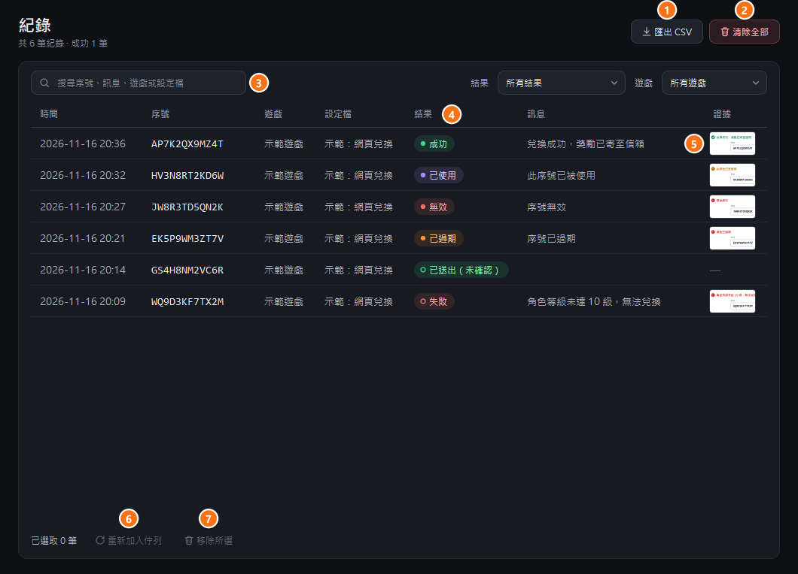

1. 「匯出 CSV」：把目前列出的紀錄存成 CSV 檔，Excel 可以直接開啟。先搜尋或篩選，就只會匯出那幾筆。
2. 「清除全部」：刪除所有紀錄，無法復原。清除後，以前兌換過的序號再匯入時就不會被自動略過。
3. 搜尋框：輸入序號、訊息、遊戲或設定檔名稱的一部分就能找到；右邊的「結果」「遊戲」可以只看某一種結果或某一款遊戲。
4. 「結果」欄：每一列是一次兌換嘗試，旁邊的「訊息」欄是從畫面讀到的文字或失敗原因。「已送出（未確認）」表示序號已送出，但設定檔沒有讀取結果的步驟，請自己到遊戲裡確認有沒有成功。
5. 「證據」欄：點一下縮圖，就能放大看當時拍下的結果截圖；放大視窗裡的「開啟資料夾」可以找到圖檔。顯示「—」表示這一筆沒有截圖。
6. 「重新加入佇列」：先點選紀錄（按住 Ctrl 或 Shift 可以多選），再按這個按鈕，序號會回到「序號」頁、狀態變成「待兌換」，下次「開始兌換」時再試一次。
7. 「移除所選」：刪掉選取的紀錄。被移除的序號，之後匯入時不會再被當成已兌換過而略過。

重試失敗的序號：在「結果」篩選選「失敗」→ 選取那幾筆 → 按「重新加入佇列」→ 回到「序號」頁按「開始兌換」。

- 「成功」和「已使用」的序號就算重新加入，開始兌換時仍會被略過；真的要再試，先移除那筆紀錄，或關閉「略過已兌換過的序號」。
- 在紀錄上按右鍵，也能「複製序號」或「檢視證據」。

### 「設定」頁

左側選單按「設定」。變更會立即儲存，不用另外按儲存。

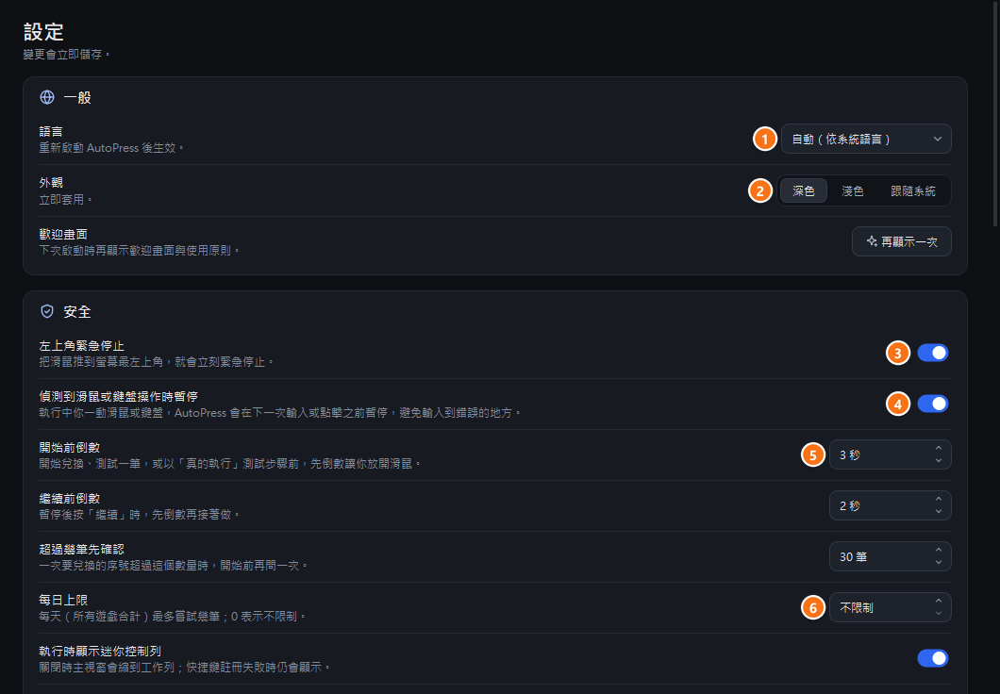

1. 「語言」：可選「自動（依系統語言）」「繁體中文」或「English」。在這裡改要重新啟動 AutoPress 才生效；只有第一次的歡迎畫面選了會馬上換。
2. 「外觀」：「深色」「淺色」「跟隨系統」，按下就立即套用。
3. 「左上角緊急停止」：執行中把滑鼠推到螢幕最左上角，就會立刻停止。預設開啟，建議不要關掉；有多個螢幕時，這一列會寫出要推到哪個角落。
4. 「偵測到滑鼠或鍵盤操作時暫停」：執行中你一動滑鼠或鍵盤，AutoPress 就先暫停，避免把序號打到錯的地方。
5. 「開始前倒數」：按「開始兌換」或「測試一筆」後先倒數（預設 3 秒），讓你放開滑鼠。下一列的「繼續前倒數」（預設 2 秒）用在暫停後按「繼續」時。
6. 「每日上限」：每天（所有遊戲合計）最多嘗試幾筆，預設「不限制」。上一列的「超過幾筆先確認」預設 30 筆：一次要兌換超過 30 筆時，開始前會再問你一次。

往下捲動還有這些設定：

- 「快捷鍵：暫停／繼續」（預設 F8）與「快捷鍵：停止」（預設 F9）：只在執行期間（和用「真的執行」測試步驟時）才會佔用這兩個按鍵。要更換就點一下欄位，再按下新的組合鍵；執行中不能更換。
- 「輸入」：「預設輸入方式」（預設「模擬鍵入（建議）」）和「切換視窗後等待」「按鍵間隔」等時間，只會套用到之後新增的步驟；已建立的步驟各自保留自己的設定。
- 「文字辨識」：「引擎狀態」顯示辨識引擎能不能用，不能用時按「重新啟動引擎」。「需確認門檻」預設 0.95，辨識信心低於這個值的字元會標成「需確認」。
- 「紀錄」：「略過已兌換過的序號」預設略過「成功」和「已使用」的序號。「保存結果截圖」的截圖可能拍到你的帳號名稱；「截圖保留天數」預設 30 天，較舊的截圖會在啟動時刪除。
- 「資料」與「可攜模式」：見[資料放在哪裡](#資料放在哪裡)。

### 「說明」頁

程式裡的「說明」頁整理了安全守則、疑難排解與緊急停止。按 F1 或左側選單的「說明」就能打開。

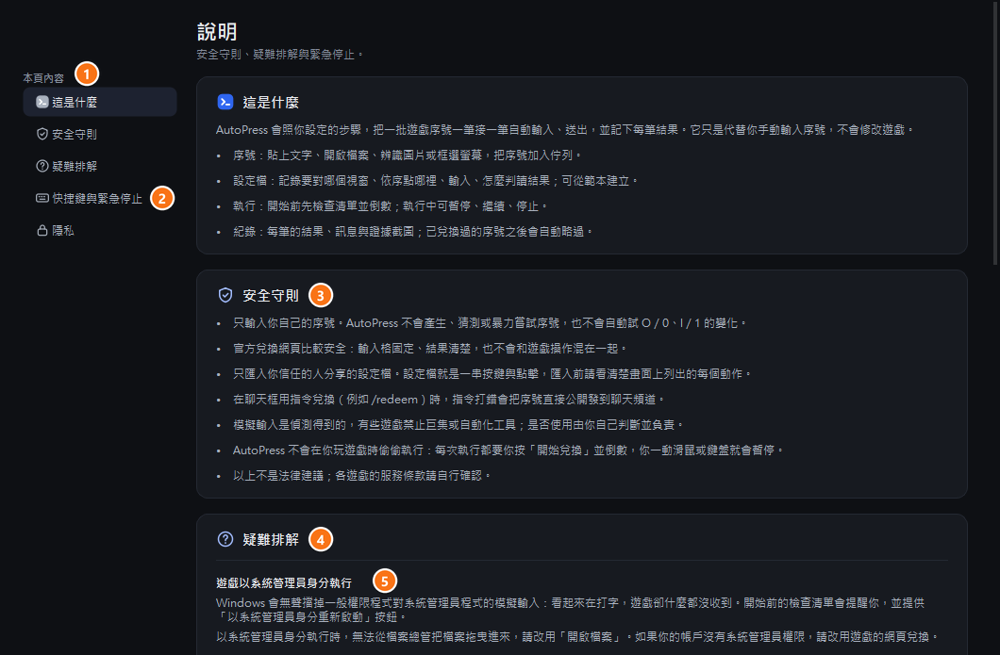

1. 「本頁內容」：點左邊的標題，就會跳到那一段。
2. 「快捷鍵與緊急停止」：列出目前的暫停／停止快捷鍵（預設 F8、F9），並畫出你的螢幕上哪個角落算緊急停止。
3. 「安全守則」：第一次使用前請讀一次，例如只輸入你自己的序號、優先使用官方兌換網頁。
4. 「疑難排解」：常見問題的解法，例如遊戲以系統管理員身分執行、全螢幕時畫面全黑、縮放比例與多螢幕、注音輸入法、找不到按鈕上的文字、「Windows 已保護您的電腦」與防毒軟體誤判。
5. 每一則都寫著原因和做法，例如「遊戲以系統管理員身分執行」；這份說明的「疑難排解」也有。

## 疑難排解

最常見的情況如下；程式裡的「說明」頁（按 F1）也有疑難排解。「Windows 已保護您的電腦」與防毒軟體的警告，見這份說明的[開頭](#第一次執行windows-的安全提醒)。

**按了開始，遊戲卻什麼都沒收到**

- 遊戲以系統管理員身分執行時，Windows 會擋下 AutoPress 的模擬輸入：看起來在打字，遊戲卻什麼都沒收到。「開始前檢查」會提醒你。
- 處理方式：按「以系統管理員身分重新啟動」→「重新啟動」，再在 Windows 的權限提示按「是」。「設定檔」頁有還沒儲存的修改時，會先問你要不要儲存。
- AutoPress 重新開啟後，要回到「執行」頁再按一次「開始兌換」。這只對這一次有效：下次一般開啟 AutoPress 時又是一般權限；也可以每次都在 `AutoPress.exe` 上按右鍵 →「以系統管理員身分執行」。
- 帳戶沒有系統管理員權限時，請改用遊戲的網頁兌換。
- 遊戲只認實體按鍵時，把「輸入序號」步驟的「輸入方式」改成「遊戲模式（按鍵碼）」（見[修改步驟](#修改步驟)）。

**英文字母變成注音、冒出中文字，或大小寫不對**

- 「輸入序號」步驟用「模擬鍵入（建議）」或「貼上（剪貼簿）」：這兩種方式直接送出字元，注音輸入法和 Caps Lock 改不到。
- 「遊戲模式（按鍵碼）」輸入時會暫時關閉目標視窗的輸入法。也可以先把輸入法切到英文。

**序號開頭幾個字不見了，或打進上一個輸入框**

- 目標視窗反應太慢時，「模擬鍵入」的字可能比清空輸入框的按鍵先到。
- 改用「貼上（剪貼簿）」或「遊戲模式（按鍵碼）」，並設定「核對範圍」：輸入的字和序號不符時就不會送出（見[修改步驟](#修改步驟)）。

**按不到「兌換」按鈕（訊息寫著「找不到文字「…」」）**

- 先確認兌換網頁或兌換視窗已經打開，而且沒有被其他視窗擋住。
- 按鈕上的字不是範本預設的「兌換」「Redeem」這類常見寫法時（例如「立即兌換」）：到「設定檔」頁往下捲到「步驟」，選「按下「兌換」按鈕」這一步，在「要點擊的文字」最後加上 `|立即兌換`（換成你的按鈕上的字），按「儲存」再測一次。
- 按「測試此步驟」可以看到它實際讀到的文字。
- 卡在第一步「確認兌換頁面已開啟」時（訊息寫著「等待「…」出現逾時」），同樣在這一步的「要等的文字」加上頁面上看得到的字。

**每一筆都是「無法判讀兌換結果」，而且「讀到的文字」是空的或不相關**

- 結果範圍框錯了，或框得太小：按「停止」，到「設定檔」頁按「重新對準」，重新框出結果訊息的範圍（框大一點）。
- 結果訊息每次都一模一樣、而且一直留在畫面上的頁面：選「辨識結果」那一步（範本裡叫「框出結果訊息的範圍」），關掉「只看送出後新出現的文字」。

**結果判斷錯了**（例如網頁說兌換成功，AutoPress 卻判成「無效」）

- 到「設定檔」頁的「結果關鍵字」修改（見[「設定檔」頁](#設定檔頁)）。
- 讀到的文字對不上任何關鍵字時，執行會停下來問你；按「加入關鍵字…」，以後同樣的訊息就會自動判定。

**全螢幕時畫面全黑**

- 獨佔全螢幕的遊戲，擷取到的畫面是全黑，文字辨識讀不到結果；執行中偵測到全黑會自動暫停。
- 在遊戲的顯示（或圖形）設定裡，把顯示模式改成「視窗」或「無邊框視窗」。

**縮放比例與多螢幕**

- 視窗大小或 Windows 縮放比例（例如 100% 改成 125%）和設定時不同，點的位置可能會偏，「開始前檢查」會提醒你。
- 視窗搬到縮放比例相同的另一個螢幕沒關係；兩個螢幕的縮放比例不同時，等於改了縮放比例。做法見[位置跑掉時：重新對準](#位置跑掉時重新對準)。

**跳出「快捷鍵無法使用」**

- F8 或 F9 已經被其他程式（例如遊戲的疊加介面）佔用。
- 這次可以按「繼續」，改用迷你控制列上的按鈕或左上角緊急停止；之後到「設定」頁把快捷鍵換成別的按鍵。

## 資料放在哪裡

設定、設定檔、序號清單、紀錄和結果截圖都只存在這台電腦的資料資料夾，預設是 `%APPDATA%\AutoPress`（在檔案總管的網址列輸入 `%APPDATA%\AutoPress` 就能打開）。「設定」頁的「資料」區也有「開啟資料夾」按鈕。

**可攜模式**：在 `AutoPress.exe` 旁邊新增一個空白文字檔，檔名改成 `portable.txt`（檔案總管沒有顯示副檔名時，改成 `portable` 就好），重新啟動 AutoPress 後，資料就會改存在程式資料夾裡的 `data` 子資料夾，可以整個資料夾放進隨身碟帶著走。

- 原本 `%APPDATA%\AutoPress` 裡的設定檔、序號和紀錄不會自動搬過去：改用可攜模式後，AutoPress 會像第一次開啟一樣，從歡迎畫面開始。要帶著舊資料，先關掉 AutoPress，把 `%APPDATA%\AutoPress` 裡的檔案複製到 `data` 子資料夾。
- 發佈的壓縮檔裡沒有 `portable.txt`，要用時自己建立。

結果截圖可能拍到你的帳號或角色名稱：分享截圖前先確認，或在「設定」頁關閉「保存結果截圖」。

## 常見問題

**以後怎麼再打開 AutoPress？** 到解壓縮出來的資料夾，按兩下 `AutoPress.exe`。想要桌面捷徑：在 `AutoPress.exe` 上按右鍵 →「傳送到」→「桌面 (建立捷徑)」（Windows 11 要先按「顯示其他選項」）。

**執行到一半關掉 AutoPress 會怎樣？** 會先問你「要結束 AutoPress 嗎？」。按「停止並結束」會先停止執行：正在處理的那一筆會變成「待兌換」或「需確認」，其他序號都留在清單裡，下次按「開始兌換」就從還沒完成的繼續。「需確認」的序號照[跑完之後](#跑完之後)處理。

**怎麼更新到新版本？** 下載新版的壓縮檔，解壓縮到新的資料夾，執行新的 `AutoPress.exe`，舊的資料夾可以刪掉。設定、序號和紀錄存在 `%APPDATA%\AutoPress`，不會受影響；用可攜模式的話，把舊資料夾裡的 `portable.txt` 和 `data` 子資料夾一起複製到新資料夾。

**怎麼移除 AutoPress？** AutoPress 沒有安裝程式：關掉 AutoPress 後，刪掉解壓縮出來的資料夾就好。連資料也要刪的話，再刪掉 `%APPDATA%\AutoPress` 資料夾。
